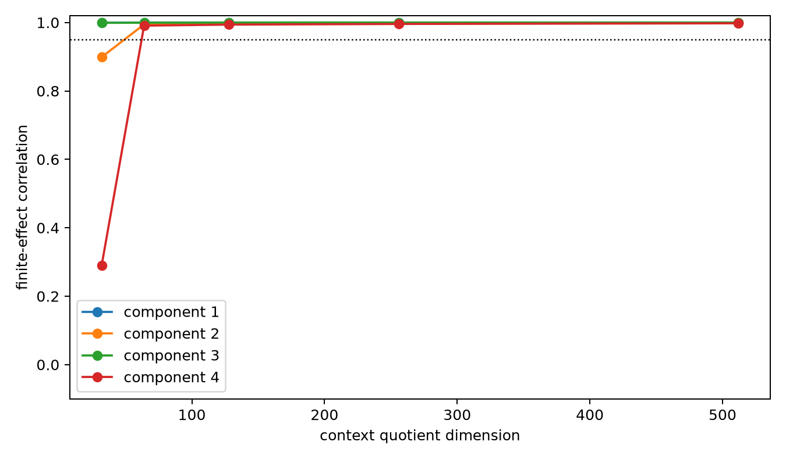

# Context-conditioned tangent interpreter

For an output query with symmetric bilinear form M and an edit δ inside the selected subspace, the exact scalar effect is `2 δᵀ M x + δᵀ M δ`. The earlier 32D interpreter replaces the full context x with its 32D projection and therefore omits cross terms with outside-state directions. This report restores increasingly large hybrid context quotients.

## Locked hypotheses

- **T1_full_context_exact: supported.**
- **T2_hybrid64_repairs_component4: supported.**
- **T3_hybrid256_general_tangent: supported.**
- **T4_outside_context_explains_failure: supported.**
- **T5_compact_tangent_threshold: supported.**

| Component | 32D | 64D | 128D | 256D | 512D | Full |
|---:|---:|---:|---:|---:|---:|---:|
| 1 | 0.999 | 1.000 | 1.000 | 1.000 | 1.000 | 1.000 |
| 2 | 0.899 | 0.994 | 0.998 | 0.999 | 0.999 | 1.000 |
| 3 | 0.999 | 0.999 | 1.000 | 1.000 | 1.000 | 1.000 |
| 4 | 0.290 | 0.991 | 0.994 | 0.996 | 0.998 | 1.000 |

Cells are correlations across the same sixteen top-mode finite edits per component. The full formula is algebraically exact; compression quality measures how much context is needed to preserve the causal tangent, not the observational scalar score.
