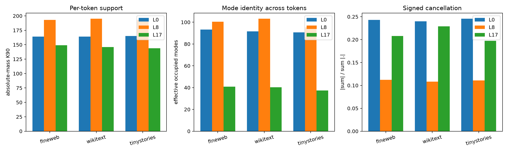

# Per-example query-mode sparsity and multiplexing

Each leading natural output query is decomposed into 512 signed interaction eigenmodes. Fixed rank follows global eigenvalue magnitude; adaptive rank selects the largest realized contributions separately for each token. Absolute-mass K90 measures per-token support, occupancy diversity measures how many different modes fill adaptive top-16 slots across the corpus, and the cancellation ratio is `|sum contributions| / sum |contributions|`.

## Locked hypotheses

- **S1_middle_is_sparse_per_example: not supported.**
- **S2_adaptive_modes_rescue_middle: supported.**
- **S3_middle_multiplexes_mode_identity: not supported.**
- **S4_middle_is_denser_than_late: not supported.**
- **S5_middle_has_more_cancellation: not supported.**
- **S6_middle_support_size_transfers: supported.**

| Layer | Group | Corpus | Per-token K90 | Eff. support | Cancellation | Occupancy eff./union | Fixed/adaptive rank-16 corr. |
|---:|---|---|---:|---:|---:|---:|---:|
| 0 | natural_top | fineweb | 164 | 68.2 | 0.243 | 93.2/342 | 0.848/0.979 |
| 0 | natural_top | wikitext | 164 | 66.0 | 0.240 | 91.6/334 | 0.877/0.980 |
| 0 | natural_top | tinystories | 165 | 70.1 | 0.245 | 90.7/324 | 0.838/0.979 |
| 0 | random | fineweb | 183 | 104.9 | 0.123 | 152.5/372 | 0.611/0.918 |
| 0 | random | wikitext | 182 | 103.3 | 0.122 | 143.1/366 | 0.617/0.918 |
| 0 | random | tinystories | 185 | 107.3 | 0.120 | 144.1/362 | 0.584/0.915 |
| 8 | natural_top | fineweb | 193 | 94.8 | 0.112 | 100.4/398 | 0.649/0.931 |
| 8 | natural_top | wikitext | 195 | 97.8 | 0.108 | 103.1/397 | 0.604/0.927 |
| 8 | natural_top | tinystories | 193 | 95.5 | 0.111 | 95.2/378 | 0.622/0.925 |
| 8 | random | fineweb | 205 | 123.7 | 0.062 | 164.0/420 | 0.461/0.858 |
| 8 | random | wikitext | 206 | 125.6 | 0.061 | 164.8/418 | 0.451/0.852 |
| 8 | random | tinystories | 204 | 124.5 | 0.063 | 144.3/406 | 0.457/0.854 |
| 17 | natural_top | fineweb | 149 | 11.3 | 0.208 | 40.9/355 | 0.970/0.991 |
| 17 | natural_top | wikitext | 146 | 10.3 | 0.229 | 40.4/348 | 0.974/0.992 |
| 17 | natural_top | tinystories | 144 | 10.2 | 0.197 | 37.4/302 | 0.967/0.987 |
| 17 | random | fineweb | 176 | 11.2 | 0.363 | 68.7/407 | 0.971/0.990 |
| 17 | random | wikitext | 174 | 9.8 | 0.387 | 67.2/400 | 0.979/0.992 |
| 17 | random | tinystories | 171 | 8.8 | 0.395 | 61.1/368 | 0.975/0.989 |

Adaptive selection is an oracle diagnostic, not an executable interpreter: it looks at the realized contribution before choosing modes. The result supports predictive conditional sparsity but rejects strict absolute-mass sparsity at layer 8: adaptive rank 16 predicts the signed score well, while roughly 193 modes are needed for 90% of absolute contribution mass. The missing object is a router that predicts the useful mode subset from context, followed by causal validation of that routed program.
