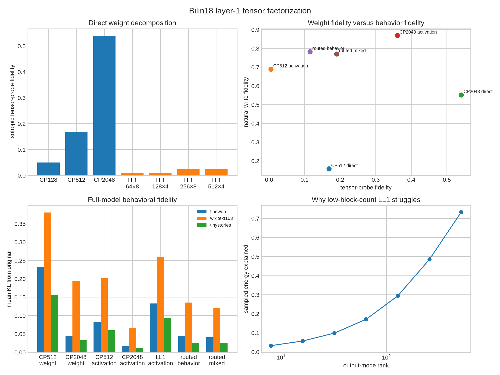

# Direct tensor factorization of Bilin18 layer 1

## Bottom line

The original layer tensor can be written implicitly as

`T = Σ_j d_j ⊗ sym(l_j ⊗ r_j)`.

A direct CP truncation to 2,048 terms (7.08M parameters) preserves
**54.0%** of held-out
isotropic tensor-probe energy and **55.3%**
of natural FineWeb write energy. Inserted into the full model without activation
distillation, it changes FineWeb cross-entropy by
**0.045 nats**
and has KL **0.045**
from the original model.

The best sparse compromise is the second follow-up, a CP-2048 factorization with
Top-K 128 routing and a mixed tensor-plus-natural objective. It preserves
**19.0%** tensor-probe energy,
**77.1%** natural
write energy, and gives FineWeb ΔCE
**0.041**.

## Decompositions

### CP

The CP student is

`f(x) = Σ_k d'_k (a_k·x)(b_k·x)`.

Native terms are ranked by their exact individual tensor Frobenius norm, retained,
and optimized on isotropic bilinear probes `(x,y)`. The probe estimator avoids
materializing the 1,152×1,152×1,152 tensor. It measures the Frobenius objective in
expectation, rather than computing every tensor entry.

| Direct model | Parameters | Tensor fidelity | Natural FineWeb write fidelity |
|---|---:|---:|---:|
| CP rank 128 | 443,648 | 0.050 | 0.045 |
| CP rank 512 | 1,771,136 | 0.168 | 0.158 |
| CP rank 2048 | 7,081,088 | 0.540 | 0.553 |

The direct optimizer does not materially improve the selected native components.
This suggests that native terms already provide a strong local CP parameterization,
or that improving a large nonconvex CP decomposition requires a better optimizer.

### LL1 block-term decomposition

An LL1 model groups `L` input bilinear factors behind one output vector:

`f(x) = Σ_r c_r Σ_(l=1)^L (a_rl·x)(b_rl·x)`.

This is the rank-`(L,L,1)` block-term model. It is attractive if many input
discriminators share an output direction. That assumption is poorly matched here.

| LL1 model | Parameters | Tensor fidelity | Natural FineWeb write fidelity |
|---|---:|---:|---:|
| R64/L8 | 1,255,040 | 0.010 | 0.062 |
| R128/L4 | 1,328,768 | 0.011 | 0.055 |
| R256/L8 | 5,016,704 | 0.025 | 0.111 |
| R512/L4 | 5,311,616 | 0.024 | 0.100 |

The sampled output mode is high-rank: its first 128 directions explain about 29%
of tensor-probe energy and 512 directions explain about 73%. Within each output
direction, the associated symmetric input matrix also needs more than L=4–8
directions. LL1 therefore compresses along precisely the mode that is broad in this
layer.

## Follow-up iteration 1: activation weighting

Starting from the direct decompositions and optimizing natural layer writes gives:

| Model | Tensor fidelity after refinement | FineWeb write fidelity | FineWeb full-model ΔCE | FineWeb KL |
|---|---:|---:|---:|---:|
| CP512 | 0.005 | 0.690 | 0.081 | 0.083 |
| CP2048 | 0.360 | 0.870 | 0.014 | 0.017 |
| LL1 R256/L8 | 0.004 | 0.634 | 0.132 | 0.133 |

Activation refinement is extremely effective behaviorally, but it rotates away from
the global tensor. CP2048 reaches 87.0% natural fidelity and nearly preserves model
behavior; CP512 loses almost all isotropic tensor fidelity while becoming a good
natural-data approximation. This is a concrete distinction between explaining the
weight function globally and explaining the part exercised by language.

## Follow-up iteration 2: sparse routing

Both routed models retain 128 of 2,048 CP factors per example.

| Routed CP2048/K128 | Tensor fidelity | FineWeb write fidelity | WikiText write fidelity | FineWeb ΔCE | WikiText ΔCE |
|---|---:|---:|---:|---:|---:|
| Behavior-only | 0.115 | 0.783 | 0.753 | 0.044 | 0.157 |
| Mixed tensor + behavior | 0.190 | 0.771 | 0.741 | 0.041 | 0.108 |

The mixed objective is the better result: it retains much more weight-level behavior,
has only a small natural-fidelity cost, and improves the full-model result on FineWeb
and WikiText. All 2,048 factors are used somewhere; effective corpus support is about
1549. The code is
sparse per token, not globally pruned to 128 universal components.

## Red-team conclusions

- **Validated:** the layer has a useful lower-rank CP description. CP2048 preserves
  54% of the global tensor and already gives a small full-model perturbation without
  activation distillation.
- **Validated:** language behavior occupies a substantially easier subdistribution
  than isotropic tensor space. Activation-refined CP2048 reaches 87% natural-write
  fidelity while preserving only 36% of isotropic probe energy.
- **Validated:** an explicit CP factorization can support sparse, input-dependent
  routing. The mixed CP2048/K128 model is the best weight/behavior/sparsity compromise.
- **Falsified at tested budgets:** LL1 is a competitive direct description of this
  layer. It underperforms CP despite comparable or larger parameter counts.
- **Caution:** the CP initialization selects native components; this is an explicit
  factorization and refinement of the trained tensor, not proof that an unrelated
  optimizer finds a unique canonical decomposition.
- **Caution:** “tensor fidelity” is estimated with held-out isotropic Gaussian
  bilinear probes. It is an unbiased route to a Frobenius-style objective, but the
  reported median per-probe fidelity is not an exact closed-form tensor norm.
- **Caution:** hard Top-K makes the routed model nonlinear and input-dependent, so it
  is no longer one fixed rank-2048 tensor after routing.

## Interpretation

There are now three distinct explanatory objects:

1. **Global weight tensor:** CP factors describe what the layer could compute on
   arbitrary residual directions.
2. **Language-supported computation:** activation refinement describes the much
   smaller region actually visited by text.
3. **Conditional sparse program:** Top-K routing selects a small set of factors for
   each token while drawing from a broad corpus-level vocabulary.

LL1 asks for reusable output modules shared by several input discriminators. Its
failure says that layer 1 does not compress naturally in that particular modular
direction. CP plus routing fits the evidence better: many bilinear discriminators,
many output directions, and sparse conditional use.

## Method reference

LL1 here follows the standard rank-`(L,L,1)` block-term definition described in
[De Lathauwer's block-term decomposition work](https://epubs.siam.org/doi/10.1137/17M1150062)
and the [Tensorlab LL1 documentation](https://www.tensorlab.net/doc/ll1.html).
