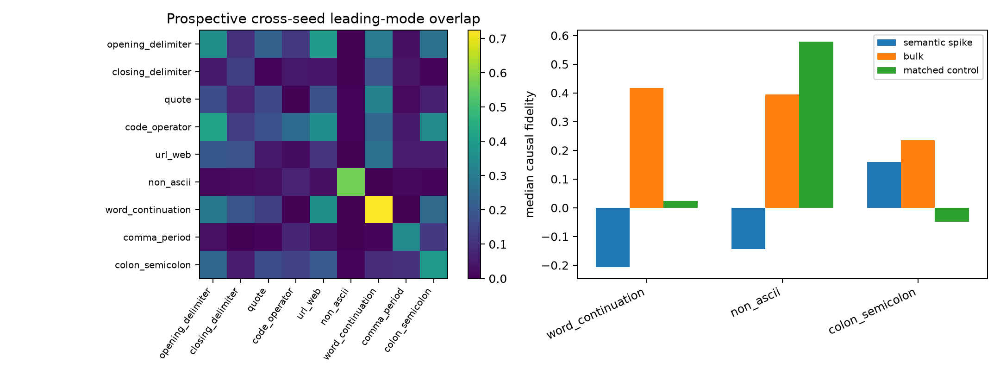

# Prospective spectral-circuit atlas

The causal candidates below were frozen from cross-seed leading-mode recurrence before causal evaluation.

## Locked hypotheses

- **A1_prospective_causality: not supported.**
- **A2_prospective_control_advantage: not supported.**
- **A3_prospective_semantics: supported.**
- **A4_all_category_matching: not supported.**
- **A5_significant_only: not supported.**

| Selected category | Cross-seed overlap | Top-1 causal | Bulk | Matched control | Full/top-1 AUROC (FineWeb) |
|---|---:|---:|---:|---:|---:|
| word_continuation | 0.724 | -0.207 | 0.417 | 0.024 | 0.799/0.608 |
| non_ascii | 0.570 | -0.144 | 0.395 | 0.579 | 0.702/0.885 |
| colon_semicolon | 0.390 | 0.160 | 0.235 | -0.049 | 0.918/0.995 |

All nine prospective categories and the exact assignment test are retained in `spectral_atlas.json`; eigensystems are in `spectral_atlas.npz`.
