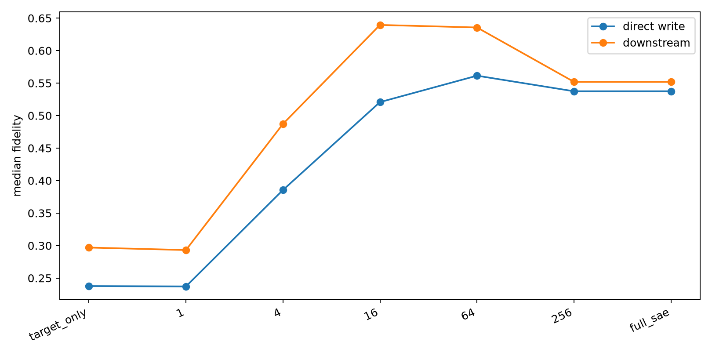

# SAE companion-path decomposition

For each known high-active spectral edit, this decomposes the actual native-product change into changes of the same SAE's Top-128 code. Companion features are ranked by `|Δcode| × decoded downstream-write norm` and reinserted before the native Down projection.

## Locked hypotheses

- **C1_full_sae_delta: supported.**
- **C2_companion_gain: supported.**
- **C3_companion_compactness: supported.**
- **C4_target_prominence: supported.**
- **C5_sparse_write_energy: not supported.**

| Reconstruction | Direct-write fidelity | Downstream fidelity |
|---|---:|---:|
| target_only | 0.238 | 0.297 |
| 1 | 0.237 | 0.293 |
| 4 | 0.386 | 0.487 |
| 16 | 0.521 | 0.640 |
| 64 | 0.561 | 0.636 |
| 256 | 0.537 | 0.552 |
| full_sae | 0.537 | 0.552 |

The named feature is top-16 by changed decoded-write contribution on **100.0%** of sites. The median number of changed features needed for 90% of summed individual decoded-write energy is **84**.

Raw feature identities and per-site reconstructions are in `spectral_companion_paths.json`.
