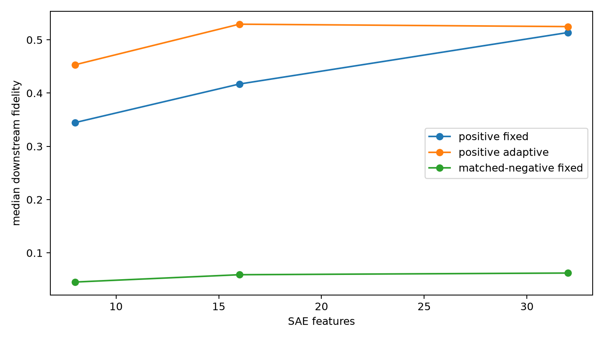

# Frozen companion-core transfer

Cores discovered on even-indexed high-active sites are applied unchanged to a separate FineWeb panel of random-active surface positives and activation-matched surface negatives.

## Locked hypotheses

- **T1_random_positive_transfer: not supported.**
- **T2_semantic_specificity: supported.**
- **T3_adaptive_retention: not supported.**
- **T4_small_core_transfer: not supported.**
- **T5_category_consistency: supported.**

| Budget | Positive fixed | Positive adaptive | Positive cross-category | Matched-negative fixed |
|---:|---:|---:|---:|---:|
| 8 | 0.345 | 0.453 | 0.000 | 0.045 |
| 16 | 0.417 | 0.529 | 0.000 | 0.059 |
| 32 | 0.514 | 0.525 | 0.000 | 0.062 |

Per-category paired results are in `spectral_companion_transfer.json`.
