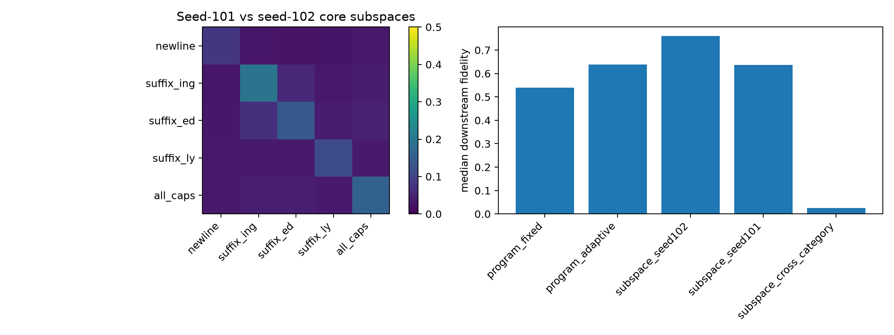

# Cross-seed companion-core canonicalization

Seed-102 companion cores are independently discovered from its own Top-128 gates and spectral modes. Exact sparse programs are evaluated separately from oracle projections into decoded-write subspaces, which are invariant to rotations inside a feature ensemble.

## Locked hypotheses

- **X1_seed102_program: supported.**
- **X2_category_subspace_match: supported.**
- **X3_seed101_subspace_transfer: supported.**
- **X4_rotated_subspace_retention: supported.**
- **X5_cross_category_specificity: supported.**

| Object | Direct fidelity | Downstream fidelity |
|---|---:|---:|
| program_fixed | 0.487 | 0.540 |
| program_adaptive | 0.522 | 0.639 |
| subspace_seed102 | 0.581 | 0.760 |
| subspace_seed101 | 0.572 | 0.636 |
| subspace_cross_category | 0.045 | 0.026 |

Same-category decoded-write subspace overlap: **0.137**; exact assignment `p=0.0083`; diagonal row maxima **5/5**.

Removing the named feature leaves companion-only diagonal overlap **0.123**, exact `p=0.0083`, and **5/5** diagonal row maxima. Thus recurrence is not a one-feature artifact. Named-feature-only matching is also 5/5.

Raw cores, overlap matrices, and site effects are in `spectral_cross_seed_companions.json`.
