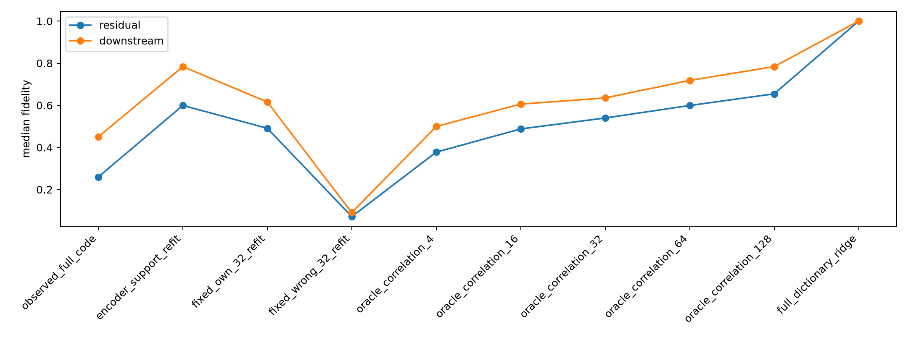

# Decoder-refit red-team

The same donor spectral intervention is evaluated after removing the SAE encoder from coefficient estimation. Supports receive least-squares-optimal coefficients for the exact native MLP residual-write change. This distinguishes dictionary span, support membership, and encoder coefficient errors.

## Locked hypotheses

- **E1_dictionary_span: supported.**
- **E2_encoder_coefficient_failure: supported.**
- **E3_oracle_compactness: not supported.**
- **E4_fixed_membership: supported.**
- **E5_category_specificity: supported.**

| Method | Residual fidelity | Downstream fidelity |
|---|---:|---:|
| observed_full_code | 0.259 | 0.450 |
| encoder_support_refit | 0.599 | 0.784 |
| fixed_own_32_refit | 0.491 | 0.616 |
| fixed_wrong_32_refit | 0.071 | 0.090 |
| oracle_correlation_4 | 0.377 | 0.499 |
| oracle_correlation_16 | 0.488 | 0.606 |
| oracle_correlation_32 | 0.540 | 0.635 |
| oracle_correlation_64 | 0.599 | 0.718 |
| oracle_correlation_128 | 0.654 | 0.784 |
| full_dictionary_ridge | 1.000 | 1.000 |

Per-example fits are in `spectral_decoder_refit.json`.
