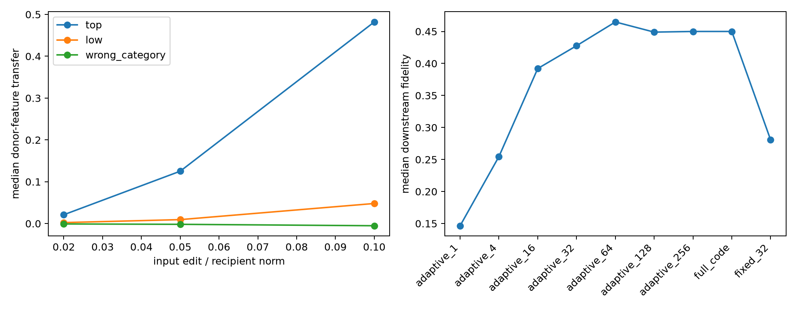

# Spectral donor-transfer dose and decomposition red-team

This tests whether donor-coordinate transfer is dose-responsive and whether its downstream effect is carried by a fixed category core, a context-adaptive sparse ensemble, or changes outside the SAE code.

## Locked hypotheses

- **R1_dose_response: supported.**
- **R2_spectral_specificity: supported.**
- **R3_full_sae_coverage: not supported.**
- **R4_adaptive_compactness: supported.**
- **R5_fixed_core_transfer: not supported.**

| Input-norm dose | Top modes | Low modes | Wrong category |
|---:|---:|---:|---:|
| 2% | 0.021 | 0.002 | -0.001 |
| 5% | 0.125 | 0.009 | -0.002 |
| 10% | 0.482 | 0.048 | -0.005 |

| Reconstruction | Downstream fidelity | Product cosine | Relative product error |
|---|---:|---:|---:|
| adaptive_1 | 0.147 | 0.332 | 0.952 |
| adaptive_4 | 0.255 | 0.438 | 0.915 |
| adaptive_16 | 0.392 | 0.417 | 0.913 |
| adaptive_32 | 0.428 | 0.391 | 0.924 |
| adaptive_64 | 0.465 | 0.366 | 0.963 |
| adaptive_128 | 0.449 | 0.387 | 0.962 |
| adaptive_256 | 0.450 | 0.387 | 0.962 |
| fixed_32 | 0.281 | 0.468 | 0.896 |
| full_code | 0.450 | 0.387 | 0.962 |

Raw paired examples are in `spectral_donor_decomposition.json`.
