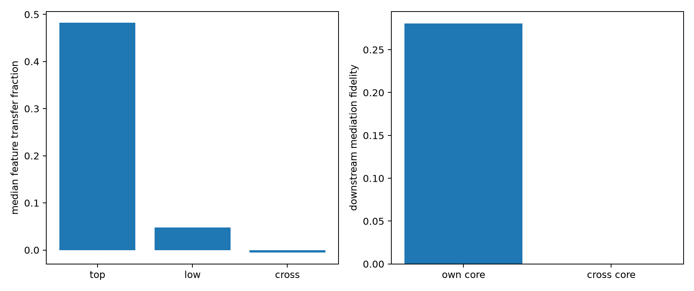

# Spectral donor-transfer test

Rank-4 raw spectral coordinates from high-active donors are copied into random-inactive recipients, capped at 10% of recipient input norm. Low-mode and next-category patches have exactly matched edit norm. The frozen 32-feature companion core then predicts the top-patch downstream effect.

## Locked hypotheses

- **D1_feature_transfer: supported.**
- **D2_gate_transfer: supported.**
- **D3_companion_mediation: not supported.**
- **D4_core_specificity: supported.**
- **D5_category_consistency: supported.**

| Patch | Feature transfer | Gate activation rate | Effect energy |
|---|---:|---:|---:|
| top | 0.482 | 95.0% | 0.00335 |
| low | 0.048 | 25.0% | 0.00117 |
| cross | -0.005 | 0.0% | 0.00173 |

Frozen own-core mediation: **0.281**; next-category core: **0.000**.

Raw donor/recipient pairs are in `spectral_donor_transfer.json`.
