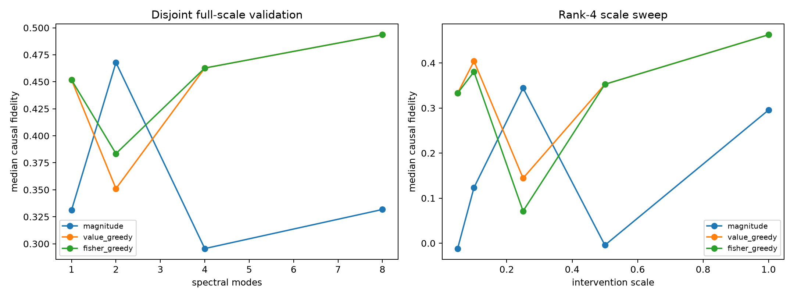

# Downstream-aware spectral mode ranking

Mode orders were fitted on one FineWeb panel and evaluated on a disjoint panel. All finite interventions follow the same native feature-coordinate path; scale 1 reproduces the original atlas intervention.

## Locked hypotheses

- **D1_downstream_rank2: not supported.**
- **D2_downstream_rank4: supported.**
- **D3_small_scale_rescue: not supported.**
- **D4_fisher_over_value: not supported.**
- **D5_cross_scale_robustness: not supported.**

| Ranking | Rank | Scale 0.1 | Scale 0.25 | Scale 0.5 | Scale 1.0 |
|---|---:|---:|---:|---:|---:|
| magnitude | 1 | 0.000 | -0.026 | -0.013 | 0.331 |
| magnitude | 2 | 0.145 | 0.003 | 0.281 | 0.468 |
| magnitude | 4 | 0.123 | 0.344 | -0.004 | 0.296 |
| magnitude | 8 | -0.056 | 0.242 | 0.279 | 0.332 |
| value_greedy | 1 | -0.085 | -0.026 | 0.066 | 0.452 |
| value_greedy | 2 | 0.170 | 0.012 | 0.281 | 0.351 |
| value_greedy | 4 | 0.404 | 0.144 | 0.353 | 0.463 |
| value_greedy | 8 | 0.085 | -0.010 | 0.180 | 0.494 |
| fisher_greedy | 1 | -0.085 | -0.026 | 0.066 | 0.452 |
| fisher_greedy | 2 | 0.170 | 0.147 | 0.281 | 0.383 |
| fisher_greedy | 4 | 0.381 | 0.071 | 0.353 | 0.463 |
| fisher_greedy | 8 | 0.085 | 0.272 | 0.180 | 0.494 |

`value_greedy` minimizes natural scalar reconstruction error. `fisher_greedy` uses the same exact spectral modes but weights discovery examples by local downstream softmax-Fisher sensitivity. Raw sites and per-category results are in `spectral_downstream_ranking.json`.
