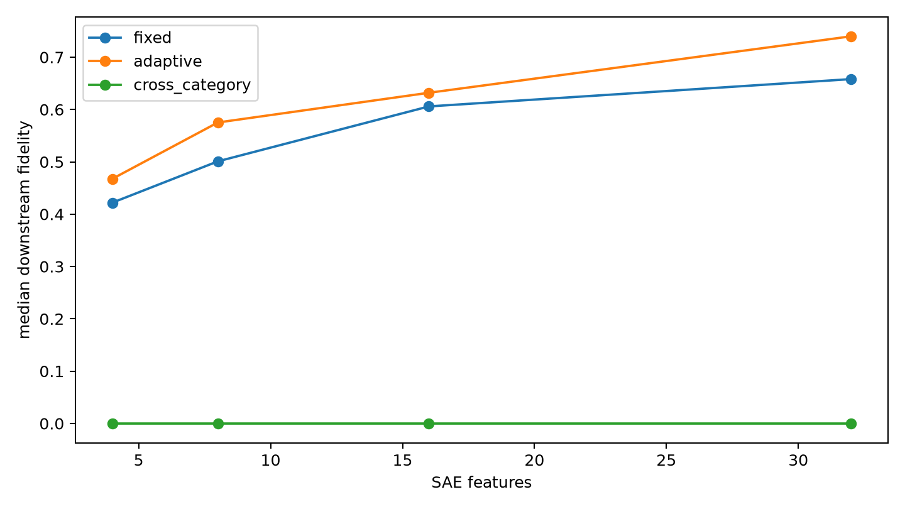

# Frozen SAE companion-core validation

Category-specific companion features are ranked by mean changed decoded-write magnitude on even-indexed high-active sites, frozen, and evaluated on odd-indexed sites. A next-category core is the specificity control.

## Locked hypotheses

- **F1_fixed_core_fidelity: supported.**
- **F2_adaptive_retention: supported.**
- **F3_category_specificity: supported.**
- **F4_named_feature_core: supported.**
- **F5_small_fixed_core: supported.**

| Budget | Fixed core | Adaptive per-site | Cross-category control | Fixed direct |
|---:|---:|---:|---:|---:|
| 4 | 0.422 | 0.467 | 0.000 | 0.371 |
| 8 | 0.501 | 0.575 | 0.000 | 0.432 |
| 16 | 0.606 | 0.632 | 0.000 | 0.486 |
| 32 | 0.658 | 0.740 | 0.000 | 0.524 |

Core memberships, named-feature ranks, and validation records are in `spectral_fixed_companions.json`.
