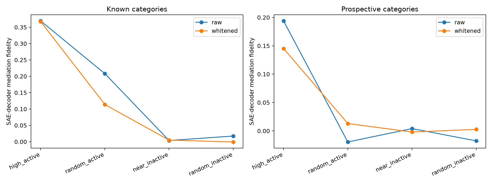

# SAE-gate-stratified spectral-path validation

This fresh FineWeb panel ignores the hand-written token category when selecting interventions. Sites are stratified by whether the exact seed-101 SAE Top-128 gate selects the feature and by feature preactivation. Surface labels are retained only for diagnosis.

## Locked hypotheses

- **G1_active_high_replication: supported.**
- **G2_gate_specificity: not supported.**
- **G3_activation_gradient: supported.**
- **G4_surface_label_residual: not supported.**
- **G5_known_prospective_gate_gap: supported.**

| Basis | Group | High active | Random active | Near inactive | Random inactive |
|---|---|---:|---:|---:|---:|
| raw | known | 0.369 | 0.208 | 0.004 | 0.017 |
| raw | prospective | 0.194 | -0.020 | 0.004 | -0.018 |
| whitened | known | 0.367 | 0.114 | 0.005 | -0.001 |
| whitened | prospective | 0.145 | 0.013 | -0.002 | 0.003 |

Values are category-median SAE-decoder mediation fidelities for rank-4, 10%-of-input-norm edits. Exact gate counts, surface-label subdivisions, and site records are in `spectral_gate_validation.json`.
