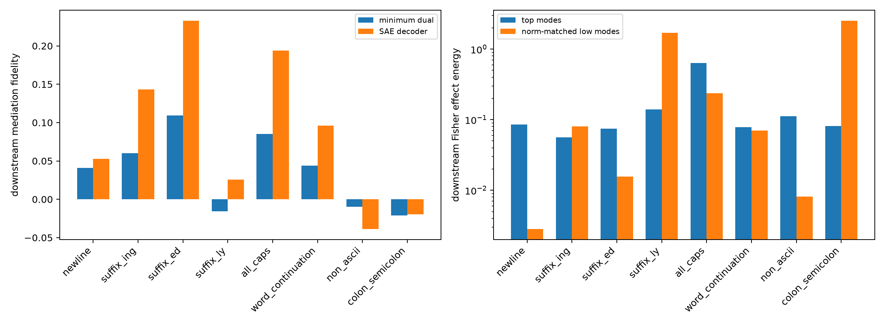

# True spectral input-subspace interventions

Unlike the earlier coordinate test, this experiment removes eigenvector components from the actual post-RMSNorm residual input, recomputes every bilinear product channel, and runs the complete downstream model. It then asks whether the effect is mediated by the proposed SAE feature coordinate.

## Locked hypotheses

- **I1_feature_selectivity: not supported.**
- **I2_downstream_specificity: not supported.**
- **I3_feature_mediation: not supported.**
- **I4_decoder_advantage: not supported.**
- **I5_prospective_gap: supported.**

| Category | Group | Rank-4 feature selectivity | Effect energy | Minimum-dual mediation | SAE-decoder mediation |
|---|---|---:|---:|---:|---:|
| newline | known | 23.18× | 0.0855 | 0.041 | 0.053 |
| suffix_ing | known | 4.72× | 0.0559 | 0.060 | 0.143 |
| suffix_ed | known | 10.26× | 0.0745 | 0.110 | 0.233 |
| suffix_ly | known | 0.58× | 0.139 | -0.016 | 0.026 |
| all_caps | known | 7.34× | 0.639 | 0.085 | 0.194 |
| word_continuation | prospective | 2.68× | 0.0787 | 0.044 | 0.096 |
| non_ascii | prospective | 3.95× | 0.112 | -0.010 | -0.039 |
| colon_semicolon | prospective | 0.08× | 0.081 | -0.021 | -0.019 |

Low-mode controls use modes 13–16 at rank 4 and are rescaled per example to exactly match the top-mode input-edit norm. Computation is float32 to avoid the bfloat16 coordinate quantization found in the precision red-team.
