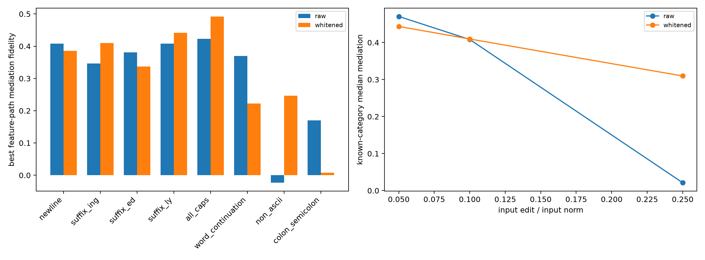

# Local spectral-input intervention red-team

The full-component ablation sometimes moved the MLP input by several times its original norm. This red-team instead makes top- and low-mode edits with exactly 5%, 10%, or 25% of the input norm, and compares raw Euclidean with covariance-whitened spectral bases.

## Locked hypotheses

- **L1_local_feature_selectivity: supported.**
- **L2_local_downstream_specificity: supported.**
- **L3_local_feature_mediation: supported.**
- **L4_basis_robustness: supported.**
- **L5_local_prospective_gap: supported.**

| Basis | Feature selectivity | Effect-energy ratio | Known top/low mediation | Decoder advantage | Prospective best median |
|---|---:|---:|---:|---:|---:|
| raw | 16.69× | 5.43× | 0.408/0.006 | 0.198 | 0.170 |
| whitened | 20.02× | 2.18× | 0.410/-0.001 | 0.230 | 0.222 |

The primary table uses 10%-of-input-norm edits. Complete 5% and 25% results and both direct-write and downstream mediation scores are in `spectral_local_input_redteam.json`.
