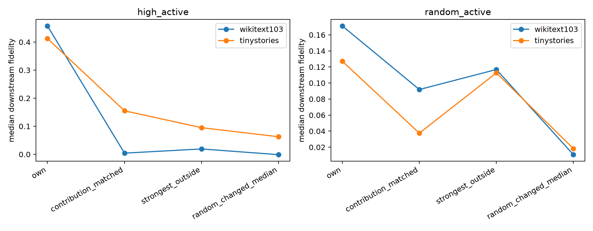

# Activity- and write-norm-matched OOD core controls

Every control uses features that actually changed under the intervention, the same active support size as the own frozen core, and an exactly matched decoded residual-write norm. The contribution-matched control greedily matches individual write scores; the strongest-outside control is deliberately adversarial.

## Locked hypotheses

- **M1_high_contribution_matched: supported.**
- **M2_high_random_matched: supported.**
- **M3_category_consistency: supported.**
- **M4_random_active_specificity: not supported.**

| Corpus | Stratum | Own | Contribution-matched | Strongest outside | Random changed |
|---|---|---:|---:|---:|---:|
| wikitext103 | high_active | 0.457 | 0.004 | 0.019 | -0.001 |
| wikitext103 | random_active | 0.171 | 0.092 | 0.117 | 0.011 |
| tinystories | high_active | 0.413 | 0.155 | 0.095 | 0.063 |
| tinystories | random_active | 0.127 | 0.038 | 0.113 | 0.018 |

Category medians and per-example matched supports are in `spectral_matched_core_controls.json`.
