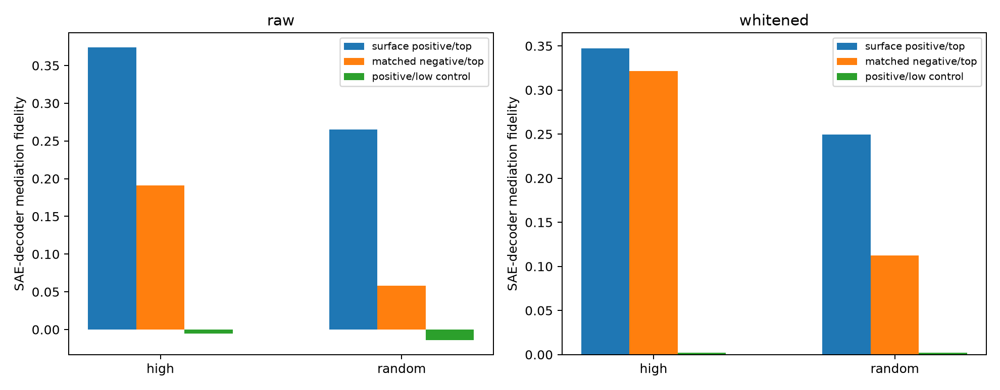

# Activation-matched semantic-route test

Active surface-positive sites are paired to active surface-negative sites with nearest SAE feature preactivation. This tests whether the category-specific spectral modes identify a distinct route into a shared active feature, rather than merely tracking activation magnitude.

## Locked hypotheses

- **M1_matched_semantic_route: supported.**
- **M2_positive_path_specificity: supported.**
- **M3_activation_match_quality: not supported.**
- **M4_cross_basis_semantic_gap: supported.**
- **M5_random_positive_generality: supported.**

| Basis | Stratum | Positive top | Matched-negative top | Positive low | Semantic gap |
|---|---|---:|---:|---:|---:|
| raw | high | 0.374 | 0.191 | -0.005 | 0.183 |
| raw | random | 0.265 | 0.058 | -0.014 | 0.207 |
| whitened | high | 0.347 | 0.321 | 0.002 | 0.026 |
| whitened | random | 0.249 | 0.113 | 0.002 | 0.137 |

All interventions are rank-4, float32, and 10% of input norm. Per-category matching diagnostics and site-level effects are in `spectral_matched_semantics.json`.
