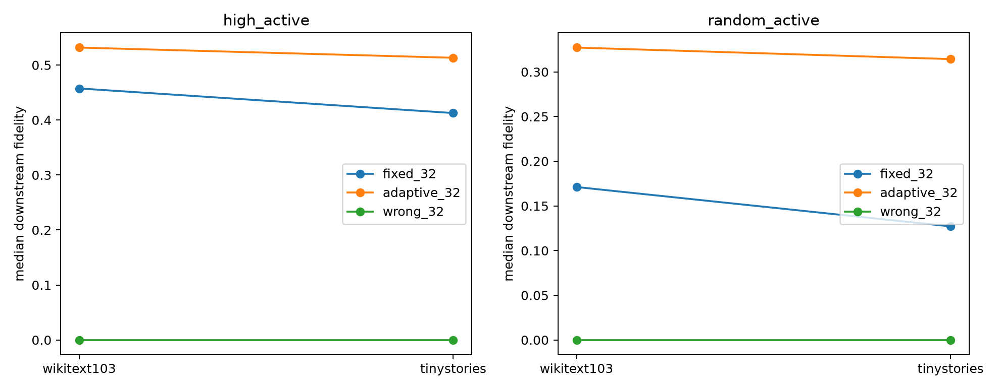

# OOD validation of frozen spectral companion cores

Frozen FineWeb-discovered category cores are evaluated on WikiText-103 and TinyStories sites selected only by the exact SAE Top-128 gate. The intervention removes the category's rank-4 input subspace at 10% input norm.

## Locked hypotheses

- **O1_high_active_ood_fidelity: supported.**
- **O2_high_active_specificity: supported.**
- **O3_adaptive_retention: supported.**
- **O4_random_active_transfer: not supported.**
- **O5_refit_membership_specificity: supported.**

| Corpus | Stratum | Fixed 16 | Fixed 32 | Adaptive 32 | Wrong 32 | Fixed-32 refit | Wrong-32 refit |
|---|---|---:|---:|---:|---:|---:|---:|
| wikitext103 | high_active | 0.389 | 0.457 | 0.532 | 0.000 | 0.604 | 0.052 |
| wikitext103 | random_active | 0.159 | 0.171 | 0.327 | 0.000 | 0.457 | 0.072 |
| tinystories | high_active | 0.331 | 0.413 | 0.513 | 0.000 | 0.630 | 0.058 |
| tinystories | random_active | 0.113 | 0.127 | 0.314 | 0.000 | 0.394 | 0.056 |

Gate counts and per-example results are in `spectral_ood_cores.json`.
