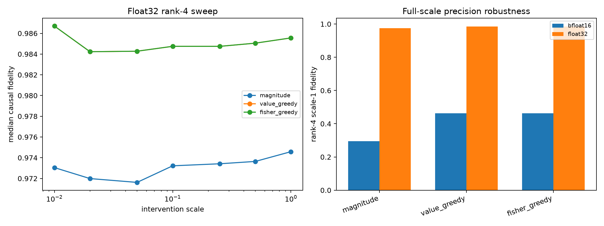

# Float32 spectral-intervention precision red-team

This reruns the frozen validation sites and frozen mode orders after converting the identical checkpoint weights to float32. It tests whether the bfloat16 scale sweep measured model curvature or numerical quantization.

## Locked hypotheses

- **P1_full_scale_robustness: not supported.**
- **P2_local_quadratic_scaling: supported.**
- **P3_local_fidelity_limit: supported.**
- **P4_reordered_rank4_survives: supported.**

| Ranking | BF16 rank-4 scale-1 | FP32 rank-4 scale-1 | Absolute difference |
|---|---:|---:|---:|
| magnitude | 0.296 | 0.975 | 0.679 |
| value_greedy | 0.463 | 0.986 | 0.523 |
| fisher_greedy | 0.463 | 0.986 | 0.523 |

Median local energy/scaling coefficient of variation: **0.007**.

The float32 model is a numerical extension of the stored checkpoint weights, not the exact deployed bfloat16 computation. Full-scale agreement establishes whether conclusions transfer between those two use cases.
