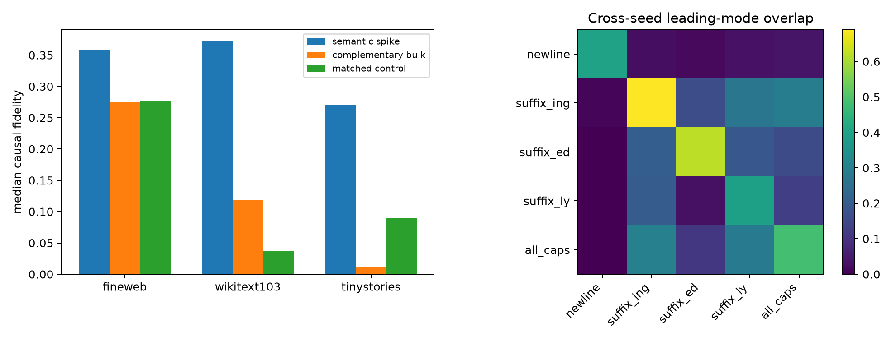

# Spectral-spike independent confirmation

## Locked hypotheses

- **C1_independent_feature_seed: supported.**
- **C2_ood_transfer: supported.**
- **C3_semantic_control_advantage: supported.**
- **C4_null_significance: supported.**
- **C5_rank1_category_stability: supported.**

| Corpus | Eligible semantic categories | Top-1 spike | Bulk | Matched control | Semantic−control | Significant-only |
|---|---:|---:|---:|---:|---:|---:|
| fineweb | 5 | 0.358 | 0.274 | 0.278 | 0.080 | 0.358 |
| wikitext103 | 5 | 0.372 | 0.118 | 0.037 | 0.336 | 0.372 |
| tinystories | 4 | 0.270 | 0.011 | 0.089 | 0.181 | 0.270 |

This run changes the learned SAE feature basis from seed 101 to seed 102, uses FineWeb rows unseen by both earlier causal analyses, and repeats the causal test on WikiText-103 and TinyStories. Categories with fewer than eight true-positive sites are reported and excluded symmetrically with their controls.

Raw results: `spectral_spike_confirmation.json`.
