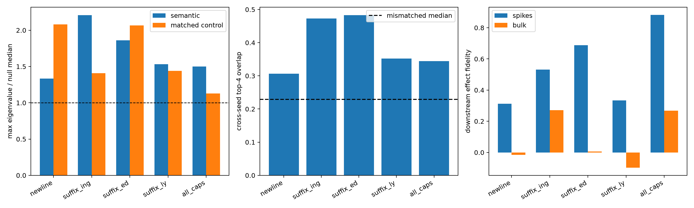

# Output-conditioned spectral-spike pilot

## Hypotheses

- **H1_semantic_spikes: not supported.**
- **H2_cross_seed_subspaces: not supported.**
- **H3_semantic_reconstruction: supported.**
- **H4_causal_spikes: supported.**
- **H5_semantic_control_advantage: supported.**

| Category | Seed 101 spike ratio | Seed 102 spike ratio | Top-4 overlap | FW full/top-4 AUC | Spike/bulk causal fidelity |
|---|---:|---:|---:|---:|---:|
| newline | 1.33 | 1.06 | 0.306 | 0.925/0.974 | 0.312/-0.016 |
| suffix_ing | 2.21 | 1.98 | 0.473 | 0.907/0.958 | 0.531/0.271 |
| suffix_ed | 1.86 | 1.55 | 0.483 | 0.876/0.918 | 0.689/0.007 |
| suffix_ly | 1.53 | 1.29 | 0.352 | 0.794/0.878 | 0.334/-0.098 |
| all_caps | 1.50 | 1.53 | 0.345 | 0.959/0.976 | 0.883/0.268 |

The interaction form is exact for each SAE encoder preactivation before ReLU/Top-K. Input covariance whitening and removal of the isotropic trace component are fixed before eigendecomposition. Sign-flipped coefficient vectors provide a per-feature empirical spectral null.

Matched controls are other SAE features selected to match encoder-coefficient and decoded-write norms. Causal interventions make the minimum-norm change to the native product vector needed to replace the chosen feature coordinate.

Raw results: `spectral_spike_pilot.json`; eigensystems: `spectral_spike_pilot.npz`.
