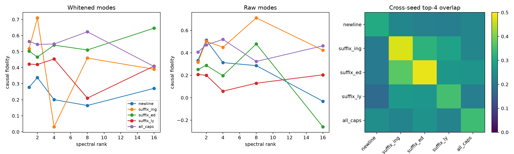

# Spectral-spike disjoint red-team

## Hypotheses

- **R1_rank2_semantics: supported.**
- **R2_rank2_causality: supported.**
- **R3_significant_only: supported.**
- **R4_rank4_plateau: not supported.**
- **R5_raw_robustness: supported.**
- **R6_category_specific_stability: supported.**

| Category | Significant modes | Rank-1 | Rank-2 | Rank-4 | Rank-8 | Rank-16 | Bulk@4 |
|---|---:|---:|---:|---:|---:|---:|---:|
| newline | 1 | 0.278 | 0.338 | 0.200 | 0.164 | 0.271 | 0.000 |
| suffix_ing | 1 | 0.517 | 0.710 | 0.031 | 0.460 | 0.390 | 0.157 |
| suffix_ed | 1 | 0.503 | 0.466 | 0.540 | 0.510 | 0.646 | 0.119 |
| suffix_ly | 1 | 0.422 | 0.420 | 0.454 | 0.210 | 0.409 | 0.193 |
| all_caps | 1 | 0.563 | 0.545 | 0.547 | 0.623 | 0.407 | 0.205 |

Sites are disjoint from the pilot and are selected by the complete centered feature form, never by a spike-only score. Raw and covariance-whitened bases are evaluated separately. `significant` retains only modes above the feature's frozen sign-flip-null threshold.

Raw results: `spectral_spike_redteam.json`.
