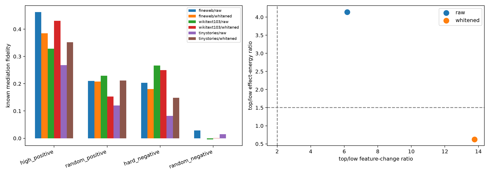

# Stratified local spectral-path replication

Each eligible category contributes 16 high positives, 16 random positives, 16 hard negatives, and 16 random negatives per corpus. Interventions are rank-4, float32, and exactly 10% of the MLP-input norm.

## Locked hypotheses

- **S1_fineweb_replication: not supported.**
- **S2_ood_positive_transfer: not supported.**
- **S3_local_selectivity: not supported.**
- **S4_positive_specificity: not supported.**
- **S5_known_prospective_gap: supported.**
- **S6_high_example_bias: not supported.**

| Corpus | Basis | Group | High positive | Random positive | Hard negative | Random negative |
|---|---|---|---:|---:|---:|---:|
| fineweb | raw | known | 0.463 | 0.210 | 0.203 | 0.029 |
| fineweb | raw | prospective | 0.293 | 0.059 | 0.009 | 0.000 |
| fineweb | whitened | known | 0.385 | 0.208 | 0.180 | -0.000 |
| fineweb | whitened | prospective | 0.203 | 0.008 | 0.010 | -0.000 |
| wikitext103 | raw | known | 0.328 | 0.229 | 0.267 | -0.004 |
| wikitext103 | raw | prospective | 0.126 | -0.005 | -0.000 | -0.000 |
| wikitext103 | whitened | known | 0.430 | 0.153 | 0.250 | 0.000 |
| wikitext103 | whitened | prospective | 0.106 | -0.000 | 0.005 | 0.000 |
| tinystories | raw | known | 0.268 | 0.120 | 0.082 | 0.015 |
| tinystories | raw | prospective | 0.134 | 0.011 | 0.007 | 0.001 |
| tinystories | whitened | known | 0.352 | 0.212 | 0.149 | 0.000 |
| tinystories | whitened | prospective | 0.050 | -0.001 | 0.005 | -0.003 |

Values are median SAE-decoder mediation fidelity across category medians. TinyStories categories with fewer than 32 positives are excluded and disclosed in the JSON.
