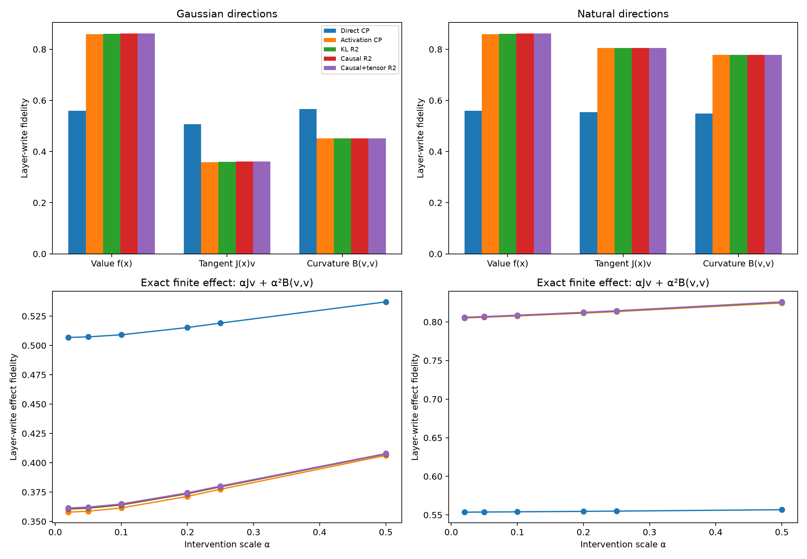

# Bilinear value–tangent–curvature ontology

A bilinear layer has an exact local decomposition:

`f(x + αv) - f(x) = α J_f(x)v + α² B_f(v,v)`.

This separates three meanings of a faithful replacement: matching values on the language manifold, matching local derivatives, and matching global/off-manifold curvature.

## FineWeb layer-write fidelity

| Model | Value | Gaussian tangent | Gaussian curvature | Natural tangent | Natural curvature |
|---|---:|---:|---:|---:|---:|
| Direct CP | 0.559 | 0.507 | 0.566 | 0.554 | 0.549 |
| Activation CP | 0.860 | 0.358 | 0.452 | 0.805 | 0.778 |
| KL R2 | 0.860 | 0.360 | 0.452 | 0.805 | 0.778 |
| Causal R2 | 0.861 | 0.361 | 0.452 | 0.805 | 0.778 |
| Causal+tensor R2 | 0.861 | 0.361 | 0.452 | 0.805 | 0.778 |

## Interpretation

- **Value fidelity** asks whether the replacement behaves correctly at states language actually visits.
- **Tangent fidelity** asks whether small causal changes are mapped in the same direction. It is the relevant layer-local object as intervention size tends to zero.
- **Curvature fidelity** asks whether the quadratic response away from the base state is preserved. Isotropic tensor probes primarily measure this global operator.
- **Finite-effect fidelity** mixes tangent and curvature with scale-dependent weights. Therefore a replacement can improve at larger edits while remaining locally wrong.
- Downstream Fisher fidelity can still differ because later layers amplify, suppress, or identify different write directions.

## Red-team limits

- Gaussian and within-corpus donor directions are only two tangent distributions.
- Layer-write agreement does not prove downstream causal agreement; the existing scorecard measures that separately.
- All CP refinements inherit the teacher-selected initialization, so these metrics compare functions rather than establish a canonical factor basis.
- Maximum absolute error in the checked quadratic identity was `2.285e-03`.

Raw results: `tangent_ontology_results.json`.
