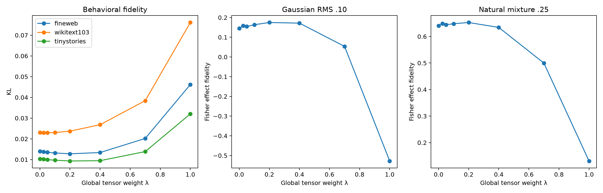

# Value–tangent blend experiment

This exploratory experiment linearly blends the causally distilled language-manifold CP with the direct tensor CP:

`f_lambda = (1 - lambda) f_language + lambda f_global`.

It tests whether the two notions of fidelity can be combined into a better end-to-end replacement.

| Global weight λ | FineWeb KL | WikiText KL | Gaussian fidelity | Natural-mix fidelity |
|---:|---:|---:|---:|---:|
| 0.000 | 0.0140 | 0.0231 | 0.146 | 0.640 |
| 0.025 | 0.0138 | 0.0230 | 0.158 | 0.649 |
| 0.050 | 0.0135 | 0.0230 | 0.154 | 0.644 |
| 0.100 | 0.0132 | 0.0230 | 0.163 | 0.648 |
| 0.200 | 0.0128 | 0.0237 | 0.175 | 0.653 |
| 0.400 | 0.0134 | 0.0268 | 0.172 | 0.634 |
| 0.700 | 0.0202 | 0.0384 | 0.054 | 0.500 |
| 1.000 | 0.0462 | 0.0761 | -0.528 | 0.131 |

## Outcome

- Best FineWeb behavior occurs at λ=0.200 (KL 0.0128).
- Best Gaussian intervention fidelity occurs at λ=0.200 (0.175).
- Best natural-mixture fidelity occurs at λ=0.200 (0.653).

A useful interior point would show that global and manifold structure are complementary. Monotonic degradation would show that direct tensor fidelity is not useful after downstream composition, despite its better layer-local isotropic tangent score.

This blend doubles stored factors if implemented literally; it is a diagnostic Pareto construction, not a compression result.

Raw results: `value_tangent_blend_results.json`.
