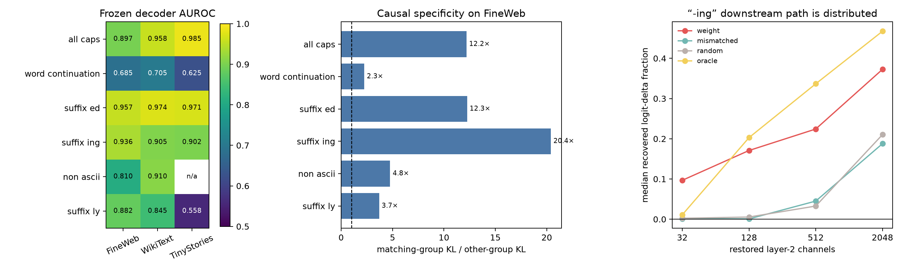

# Weight-first discovery of six layer-1 circuits

## Bottom line

Yes: a useful local circuit can be proposed from isolated-token neuron responses and weight matrices, then validated on text that played no role in discovery. The clearest example is an **“-ing” detector in layer 1**. Four frozen neurons recognize it across FineWeb, WikiText-103, and TinyStories; their joint ablation is 20.4× more disruptive on selected “-ing” sites than the average ablation of the other five groups; and the layer-1→layer-2 weights predict which downstream neurons change by 4.9× over the layer-2 average.

It is not a small end-to-end circuit. Restoring the 32 strongest weight-predicted layer-2 targets recovers a median 9.7% of the logit effect; even 2,048 of 4,608 targets recover only 37.3%. The result is therefore a **clean source predicate feeding a distributed downstream computation**, not a four-neuron semantic module with a few output wires.



## What “weight-first” means here

No natural-language corpus was opened during discovery. Every tokenizer item was run as an isolated one-token sequence. Even token IDs selected channels; odd token IDs tested them. Category names came from predeclared tokenizer-string predicates, so this is *not* unsupervised semantics from raw matrices alone. It is a strict “weights plus vocabulary inventory” search. The source groups and downstream layer-2 rankings were frozen before FineWeb, WikiText, or TinyStories validation.

Layer-2 targets were ranked using only the local path magnitude

`layer1 product channel → layer1 Down direction → layer2 Left/Right factors`.

## Six frozen hypotheses

| circuit | layer-1 neurons | isolated held-out AUROC | natural AUROC: FW / WT / TS | causal specificity | top-32 delta enrichment | median recovery: 32 / 2048 |
|---|---|---:|---:|---:|---:|---:|
| all_caps | 2930, 1952, 2275, 2746 | 0.993 | 0.897 / 0.958 / 0.985 | 12.2× | 4.1× | -2.5% / 27.1% |
| word_continuation | 3720, 624, 876, 2021 | 0.981 | 0.685 / 0.705 / 0.625 | 2.3× | 2.0× | 5.4% / 13.3% |
| suffix_ed | 3357, 597, 2246, 3880 | 0.971 | 0.957 / 0.974 / 0.971 | 12.3× | 4.2× | 6.6% / 24.4% |
| suffix_ing | 896, 2780, 3712, 1846 | 0.971 | 0.936 / 0.905 / 0.902 | 20.4× | 4.9× | 9.7% / 37.3% |
| non_ascii | 1687, 43, 413, 488 | 0.954 | 0.810 / 0.910 / n/a | 4.8× | 3.8× | 17.1% / 29.7% |
| suffix_ly | 2135, 314, 1495, 2852 | 0.945 | 0.882 / 0.845 / 0.558 | 3.7× | 2.4× | 10.5% / 18.1% |

TinyStories contains no positive non-ASCII examples in this panel, so its AUROC is undefined. “Word continuation” and “-ly” are the weakest transfers; they remain in the table because hypotheses were frozen rather than replaced after seeing natural data.

## Concrete “-ing” circuit

Source code:

- neuron 896: isolated-token standardized gap +4.40; mean one-neuron ablation KL 0.004098
- neuron 2780: isolated-token standardized gap -3.55; mean one-neuron ablation KL 0.003271
- neuron 3712: isolated-token standardized gap +2.97; mean one-neuron ablation KL 0.0009073
- neuron 1846: isolated-token standardized gap +2.85; mean one-neuron ablation KL 0.001637

The signs matter: neuron 2780 becomes quieter for “-ing”, while 896, 3712, and 1846 become larger. The four-channel decoder therefore uses a signed pattern, not merely “four neurons turn on.” Each source neuron is independently causal, although 896 and 2780 have the largest average effects. The sum of four separate ablation-induced logit changes has median cosine 0.704 with the simultaneous four-neuron ablation and norm ratio 1.226; the circuit is only moderately linear once propagated through 16 later layers.

One held-out FineWeb site was:

> … quite have the traction of corona related stuff.
On 19 Dec 2021 at 10:20pm Tom Pain wrote:
Source? Time? Date? If you really found something you'd be gagging

The current token is `agging`. At this site the 32 weight-ranked layer-2 targets changed 5.8× more than an average layer-2 channel. The particular example is also a warning: restoring those targets did not repair the final output for this site. Across sites, recovery becomes reliable only for much larger target sets.

## Red-team results

1. **Semantic transfer:** “-ed” and “-ing” are strong on all three corpora. All-caps is also strong. Word-continuation degrades to 0.625–0.705; “-ly” falls to 0.558 on TinyStories. Token-inventory success alone would have overstated those circuits.
2. **Cross-circuit ablations:** all six matching groups beat the average other group, with ratios from 2.3× to 20.4×. This controls for generic damage from ablating four layer-1 channels, though selection of high-scoring positive sites favors the matching group.
3. **Individual-neuron concentration:** the “-ing” result is not carried by one neuron. Mean one-neuron KLs range from 0.0009073 to 0.004098; the simultaneous group effect is 1.13× the sum of individual KLs.
4. **Weight-path prediction:** for “-ing”, the top 32 predicted targets have 4.9× the average standardized activation change. The advantage declines as the set expands, as it should: 1.36× at 2,048 targets.
5. **Sufficiency fails at small scale:** 32-target restoration is weak and sometimes negative. Negative recovery means the partial repair perturbed compensating downstream interactions more than it helped. Even the post-hoc oracle ranking is not monotonic, demonstrating nonlinear interactions and making “percentage stored in these neurons” an invalid interpretation.
6. **Control rankings:** for “-ing”, 2,048 weight-ranked targets recover a median 37.3%, versus 18.8% for another circuit's ranking and 21.0% for random targets. The weights contain circuit-specific information, but much of the path is broad.

## Interpretation

This is the coexistence regime we were looking for. The source representation is fairly neuron-aligned and verb-like: a small signed set discriminates a morphological condition. Causation after that point is dense. Dense connectivity does not make the source neurons meaningless, and clean source neurons do not imply a compact downstream circuit.

The strongest warranted claim is local: **we can discover a semantic detector and a statistically predictive downstream route from weights and the vocabulary, then validate both causally.** We cannot yet recover a faithful sparse end-to-end mechanism from weights alone. The next useful step is to trace “-ing” through layer 2 using low-rank subspaces or groups of downstream neurons rather than expecting individual target neurons to be sufficient.

## Reproduction

```bash
uv run python scripts/discover_bilin18_weight_only_circuits.py
uv run python scripts/validate_bilin18_weight_only_circuits.py
MPLBACKEND=Agg uv run python scripts/report_bilin18_weight_only_circuits.py
```

Raw results: `discovery.json` and `validation.json` in this directory.
