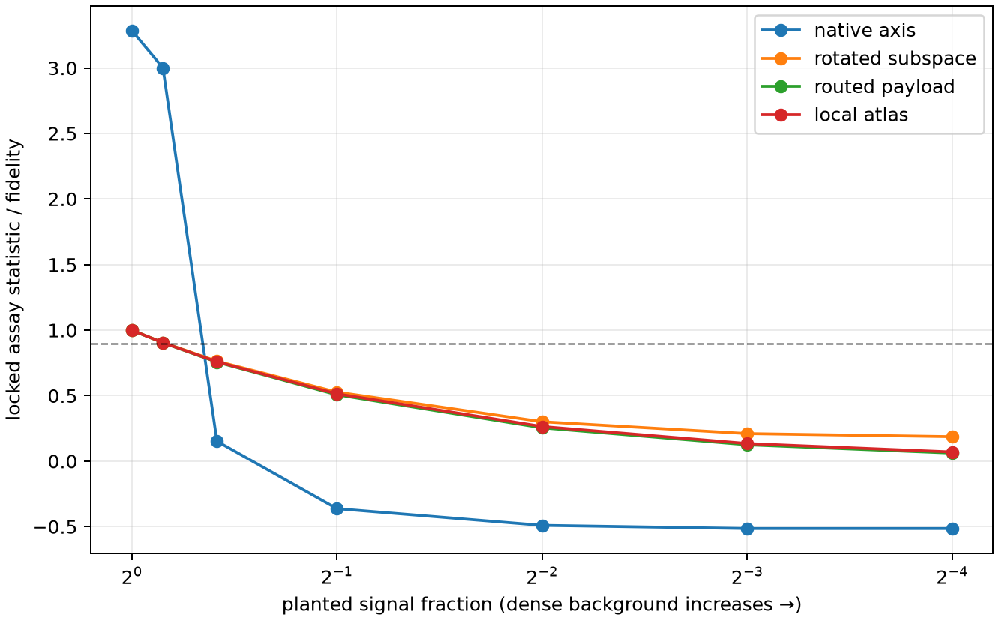

# Ground-truth computation-assay benchmark

This benchmark asks whether the planned interpretability assays recover mechanisms that are known to exist before their absence is interpreted in a real model.

## Pure-mechanism qualification

| qualification gate | seeds passing / 5 |
|---|---:|
| native axis detected | 5/5 |
| rotated axis not privileged | 5/5 |
| rotated subspace recovered | 5/5 |
| oracle router payload recovered | 5/5 |
| fixed router payload fails | 5/5 |
| full router recovered | 5/5 |
| local atlas recovered | 5/5 |
| global rank4 fails atlas | 5/5 |
| dense identity exact | 5/5 |
| dense compact methods fail | 5/5 |
| constraint kernel exact | 5/5 |
| constraint null low | 5/5 |
| constraint nonlinear small scale | 5/5 |
| taut is stronger | 5/5 |
| diffuse is broader | 5/5 |

## Dense-background sufficiency curves

A hit means the original locked pure-mechanism threshold still passes after adding a norm-matched dense background. This asks whether the planted mechanism remains sufficient for the whole effect; it is not a test of whether a weaker component remains present.

| family | signal 1 | signal 0.9 | signal 0.75 | signal 0.5 | signal 0.25 | signal 0.125 | signal 0.0625 |
|---|---:|---:|---:|---:|---:|---:|---:|
| native axis | 5/5 (3.285) | 5/5 (3.000) | 0/5 (0.152) | 0/5 (-0.363) | 0/5 (-0.490) | 0/5 (-0.515) | 0/5 (-0.515) |
| rotated subspace | 5/5 (1.000) | 0/5 (0.906) | 0/5 (0.763) | 0/5 (0.527) | 0/5 (0.301) | 0/5 (0.211) | 0/5 (0.187) |
| routed payload | 5/5 (1.000) | 5/5 (0.904) | 0/5 (0.757) | 0/5 (0.507) | 0/5 (0.255) | 0/5 (0.125) | 0/5 (0.062) |
| local atlas | 5/5 (1.000) | 0/5 (0.904) | 0/5 (0.759) | 0/5 (0.514) | 0/5 (0.265) | 0/5 (0.135) | 0/5 (0.070) |

## Verdict

All pure-mechanism gates passed in every seed: **True**.

A failed pure gate is an assay failure, not a scientific null. The mixture curves define when a planted component remains nearly sufficient. They cannot by themselves exclude a weaker component. Full per-seed values are in `results.json`.

