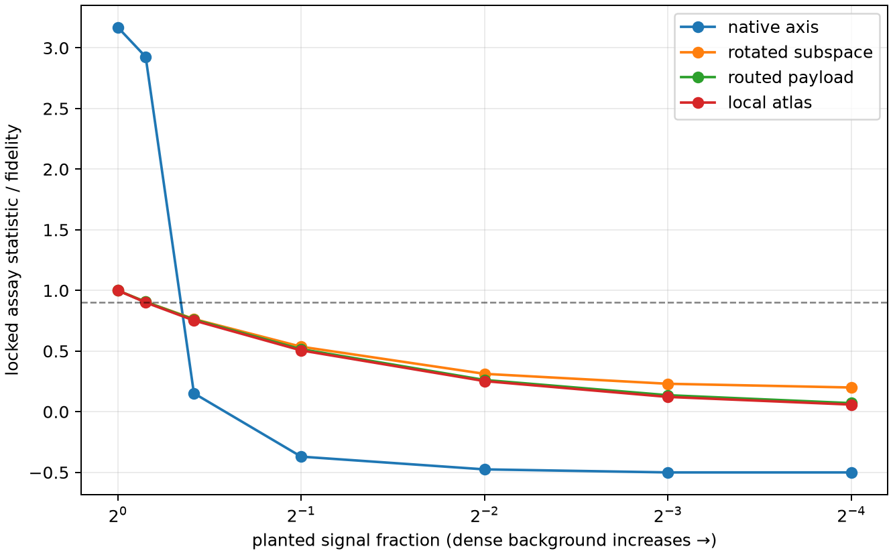

# Ground-truth computation-assay benchmark

This benchmark asks whether the planned interpretability assays recover mechanisms that are known to exist before their absence is interpreted in a real model.

## Pure-mechanism qualification

| qualification gate | seeds passing / 5 |
|---|---:|
| native axis detected | 1/5 |
| rotated axis not privileged | 1/5 |
| rotated subspace recovered | 1/5 |
| oracle router payload recovered | 1/5 |
| fixed router payload fails | 1/5 |
| full router recovered | 1/5 |
| local atlas recovered | 1/5 |
| global rank4 fails atlas | 1/5 |
| dense identity exact | 1/5 |
| dense compact methods fail | 1/5 |
| constraint kernel exact | 1/5 |
| constraint null low | 1/5 |
| constraint nonlinear small scale | 1/5 |
| taut is stronger | 1/5 |
| diffuse is broader | 1/5 |

## Dense-background sufficiency curves

A hit means the original locked pure-mechanism threshold still passes after adding a norm-matched dense background. This asks whether the planted mechanism remains sufficient for the whole effect; it is not a test of whether a weaker component remains present.

| family | signal 1 | signal 0.9 | signal 0.75 | signal 0.5 | signal 0.25 | signal 0.125 | signal 0.0625 |
|---|---:|---:|---:|---:|---:|---:|---:|
| native axis | 1/5 (3.170) | 1/5 (2.926) | 0/5 (0.152) | 0/5 (-0.370) | 0/5 (-0.475) | 0/5 (-0.500) | 0/5 (-0.500) |
| rotated subspace | 1/5 (1.000) | 0/5 (0.906) | 0/5 (0.764) | 0/5 (0.536) | 0/5 (0.312) | 0/5 (0.230) | 0/5 (0.200) |
| routed payload | 1/5 (1.000) | 1/5 (0.905) | 0/5 (0.760) | 0/5 (0.516) | 0/5 (0.262) | 0/5 (0.136) | 0/5 (0.071) |
| local atlas | 1/5 (1.000) | 0/5 (0.901) | 0/5 (0.752) | 0/5 (0.506) | 0/5 (0.252) | 0/5 (0.122) | 0/5 (0.059) |

## Verdict

All pure-mechanism gates passed in every seed: **True**.

A failed pure gate is an assay failure, not a scientific null. The mixture curves define when a planted component remains nearly sufficient. They cannot by themselves exclude a weaker component. Full per-seed values are in `results.json`.

