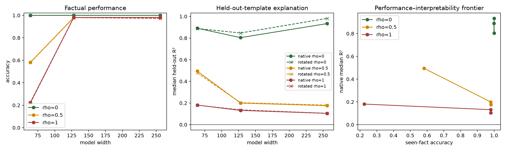

# Factual capacity and neuron organization: amended Stage 1 pilot

This is a one-data-seed, one-initialization exploratory pilot. It uses 2 independently identified entities per trait tuple, stable nested random targets, and a native-axis versus random-rotation null. It is not the replicated confirmatory result.

## Correctness and resources

- Entities: 8,192; fact pairs: 65,536.
- Manifest hash: `9b6270c610d3b1b3328db674281904d198ab3889046653acd76b55aace278a26`.
- Unique IDs, rule reconstruction, exact full-table balance, split disjointness, and all rho-specific balance checks passed.
- Total training time for the grid: 9.3 minutes; maximum allocated training memory: 447 MiB.
- This working directory has no Git metadata, so a revision could not be recorded; the manifest hash and saved source/configuration are the available provenance.

## Performance

Fixed is trained-template seen-fact recall; transfer uses an unseen combination of familiar field order and markers. Changed recall excludes chance coincidences. Held-out changed facts should remain near 12.5% chance.

| rho | width | params | steps | fixed | transfer | changed recall | structured/unselected | held-pair changed | held-pair structured |
|---:|---:|---:|---:|---:|---:|---:|---:|---:|---:|
| 0 | 64 | 170,368 | 2,000 | 0.999 | 0.999 | — | 0.999 | — | 0.998 |
| 0 | 128 | 668,416 | 2,000 | 1.000 | 1.000 | — | 1.000 | — | 1.000 |
| 0 | 256 | 2,647,552 | 2,000 | 1.000 | 1.000 | — | 1.000 | — | 1.000 |
| 0.5 | 64 | 170,368 | 10,000 | 0.582 | 0.580 | 0.091 | 0.962 | 0.015 | 0.901 |
| 0.5 | 128 | 668,416 | 29,250 | 0.980 | 0.979 | 0.971 | 0.988 | 0.051 | 0.593 |
| 0.5 | 256 | 2,647,552 | 26,250 | 0.982 | 0.980 | 0.973 | 0.988 | 0.060 | 0.617 |
| 1 | 64 | 170,368 | 10,000 | 0.225 | 0.220 | 0.225 | — | 0.119 | — |
| 1 | 128 | 668,416 | 44,000 | 0.980 | 0.980 | 0.981 | — | 0.129 | — |
| 1 | 256 | 2,647,552 | 24,000 | 0.980 | 0.973 | 0.980 | — | 0.134 | — |

## Held-out neuron explanations

Candidate explanations were fixed before reading activations. Group means are fit on trained template 0, the candidate is selected on trained template 1, and its reported R²/tail score is evaluated on held-out template 6. Rotations are exact orthogonal coordinate nulls at the post-SwiGLU interface.

| rho | width | native semantic R² | rotated semantic R² | native entity-lookup R² | native fact-lookup R² | native tail BA | rotated tail BA |
|---:|---:|---:|---:|---:|---:|---:|---:|
| 0 | 64 | 0.891 | 0.888 | 0.626 | 0.980 | 0.888 | 0.890 |
| 0 | 128 | 0.804 | 0.847 | 0.624 | 0.973 | 0.852 | 0.872 |
| 0 | 256 | 0.934 | 0.982 | 0.631 | 0.988 | 0.911 | 0.972 |
| 0.5 | 64 | 0.495 | 0.478 | 0.668 | 0.981 | 0.738 | 0.723 |
| 0.5 | 128 | 0.199 | 0.203 | 0.780 | 0.995 | 0.642 | 0.614 |
| 0.5 | 256 | 0.175 | 0.180 | 0.667 | 0.989 | 0.632 | 0.609 |
| 1 | 64 | 0.181 | 0.180 | 0.880 | 0.935 | 0.626 | 0.609 |
| 1 | 128 | 0.132 | 0.137 | 0.738 | 0.995 | 0.607 | 0.590 |
| 1 | 256 | 0.104 | 0.105 | 0.733 | 0.985 | 0.591 | 0.579 |

## Sampled causal and component effects

Effective support ranges from 1 to 8; larger values mean effects are spread across more attribute groups. It is a breadth statistic, not proof that the groups are semantically unrelated.

| rho | width | native effect | rotated effect | native attribute support | rotated attribute support | max MLP-layer loss Δ | max attention-head loss Δ |
|---:|---:|---:|---:|---:|---:|---:|---:|
| 0 | 64 | 0.061 | 0.056 | 6.21 | 6.62 | 0.811 | 1.821 |
| 0 | 128 | 0.022 | 0.022 | 6.40 | 6.12 | 0.318 | 0.439 |
| 0 | 256 | 0.016 | 0.012 | 6.97 | 7.29 | 0.000 | 0.000 |
| 0.5 | 64 | 0.026 | 0.035 | 7.27 | 7.57 | 0.292 | 0.330 |
| 0.5 | 128 | 0.189 | 0.270 | 7.72 | 7.92 | 2.447 | 1.668 |
| 0.5 | 256 | 0.070 | 0.127 | 7.45 | 7.86 | 2.328 | 1.294 |
| 1 | 64 | 0.013 | 0.013 | 7.78 | 7.89 | 0.053 | 0.061 |
| 1 | 128 | 0.269 | 0.409 | 7.48 | 7.88 | 7.515 | 5.746 |
| 1 | 256 | 0.110 | 0.182 | 7.36 | 7.87 | 6.401 | 3.595 |

## Gate-based interpretation

4 arbitrary-load conditions passed both fidelity gates. These cells permit the planned matched-fit neuron comparison; their native-minus-rotated and narrow-versus-wide differences remain exploratory until replicated.

## Pilot observations

1. **Capacity changes storage speed and success.** At full randomization, width 64 reached only 22.5% after 10,000 updates. Width 128 required 44,000 updates and width 256 required 24,000 to reach roughly 98% full-random recall.
2. **The narrow mixed model favors the shared rule.** At rho=0.5, width 64 retained 90.1% accuracy on held-out structured pairs but stored few changed facts. The high-fit width-128/256 models stored changed facts while structured held-pair accuracy fell to 59.3% and 61.7%.
3. **Arbitrariness reduces the locked semantic score, but extra width does not restore it.** At rho=0.5 the native median R² is 0.199 at width 128 and 0.175 at width 256. At rho=1 it is 0.132 and 0.104.
4. **The native-axis advantage is weak under this metric.** Native and rotated semantic R² are nearly equal in the loaded high-fit cells. Native positive-tail balanced accuracy is modestly above the rotated null, but the gap is only a few points and needs seed replication.
5. **Loaded activations remain highly fact-stable.** Fact-pair lookup reaches R²=0.995 and 0.985 in the full-random high-fit models, while entity lookup reaches 0.738 and 0.733. These high-complexity lookups show template-stable addressing, but cannot distinguish a coherent address code from distributed memorization.
6. **Memory is not confined to the audited MLP axes.** Both whole final-position MLP-layer ablations and individual attention-head ablations have substantial effects under load, so the result is about the organization of the probed interface, not the entire storage mechanism.

Negative held-out R² means the locked simple vocabulary predicts a channel worse than its held-out-template mean; it should be read as ‘unexplained by this audit,’ not as proof of polysemanticity. Tail balanced accuracy has a 0.5 null. Sampled ablations replace a final-position native or rotated coordinate by its discovery-panel mean and recompute normalization and every downstream block.

## Next decision

Replicate the established boundary first: widths 64/128/256 at rho 0.5 and 1.0, paired across at least three new data seeds and two initialization seeds. Preserve the current explanation vocabulary and sampling rules. The present pilot supports a performance-sacrifice result for width 64 and a shift from simple semantic predictability toward fact-specific addressing in high-fit loaded models; it does not yet support capacity-dependent recovery of coherent native neurons or a claim of superposition.
