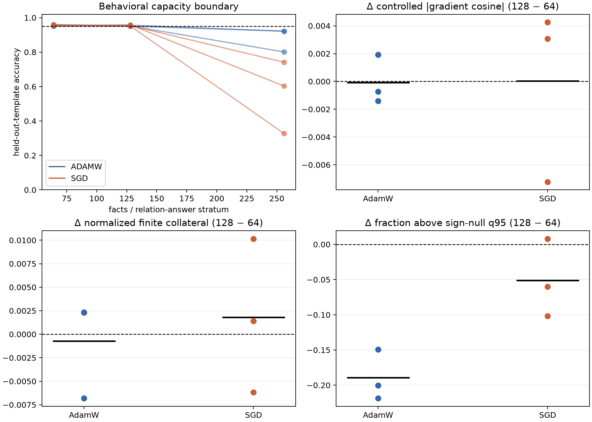

# Mechanism transition: matched load × optimizer factorial

## Bottom line

Doubling the number of successfully learned arbitrary facts from 64 to 128 ranks did **not** reproducibly tighten the transformer constraint web. Raw effective support rose in all six paired cells, but this was a noise-floor artifact: sign-null-corrected support and the fraction of supranull edges generally fell. Coupling magnitude and normalized finite collateral had mixed seed signs.

This falsifies the simple universal saturation story on this substrate. It does not falsify the one-layer KKT result or rule out a transition caused by depth, residual paths, normalization, a still-tighter successfully fit model, or a different optimizer limit.

## Behavioral gate

All 12 load-64/load-128 cells passed the fixed-template and unseen-template gate. No load-256 cell passed:

- AdamW: 0/3 load-256 gates
- SGD: 0/3 load-256 gates

Load 256 is therefore a replicated capacity/optimization boundary, not part of the learned-geometry comparison.

## Paired primary effects (load 128 minus 64)

| optimizer | controlled coupling | finite collateral | raw support | support above sign null | supranull edge fraction | coupling/null ratio |
|---|---:|---:|---:|---:|---:|---:|
| ADAMW | -0.00007 | -0.00073 | +2.06 | -5.18 | -0.189 | -1.634 |
| SGD | +0.00004 | +0.00180 | +2.13 | -0.91 | -0.051 | -0.473 |

The finite-edit predictor remained valid in every retained cell; the minimum pooled origin-R² was **0.996**.

## KKT red team

A 64-constraint nonnegative stationarity fit was computed for every block and its MLP-only parameters. It is descriptive, not a KKT theorem: the transformer is normalized and residual, the panel is a small subset of all training constraints, and its fraction of the training table halves when load doubles.

| optimizer | Δ final-weight MLP KKT cosine | Δ displacement-from-init MLP KKT cosine |
|---|---:|---:|
| AdamW | -0.014 | -0.033 |
| SGD | +0.041 | -0.037 |

Final-weight alignment rises for SGD but displacement alignment falls for both optimizers. Because initialization choice reverses the apparent conclusion and the constraint panel is incomplete, this does not validate a transformer KKT interpretation. It identifies the next controlled bridge: remove normalization/residual paths and compute stationarity using the complete constraint set in a small model.

## Red-team changes that mattered

1. Loads are literal nested prefixes of one fact table with stable random targets.
2. Every seed uses the same 64 fact identities across loads and optimizers, balanced over relation × answer.
3. Every fact uses the same competitor, selected from the mean probability across the four matched models.
4. Gradient coupling is compared with a coordinate-sign null preserving gradient norms and magnitude patterns.
5. Current weights and displacement from the reproduced initialization are reported separately.

## Updated hypothesis

In these normalized residual transformers, adding learnable arbitrary facts expands a diffuse background of tiny sensitivities rather than reliably making existing fact constraints more load-bearing. Taut KKT-like organization is more likely a special regime requiring a simpler homogeneous architecture, complete active-constraint coverage, or substantially tighter successful saturation—not a generic consequence of factual load.

