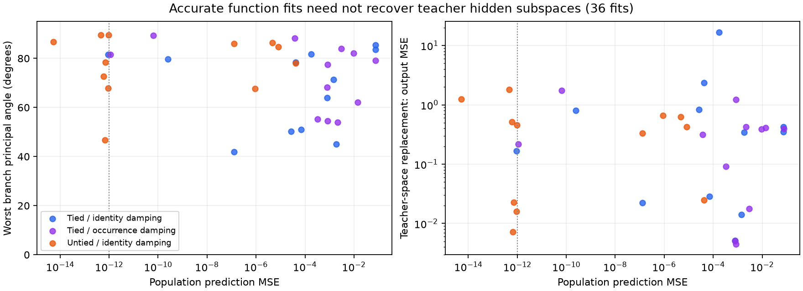

# Function fitting versus hidden-computation recovery

All36Gauss–Newton endpoints were assessed without retraining. Eight satisfy the already-used population-MSE<1e-12criterion. None of those eight recovers the teacher hidden subspaces under branchwise linear basis changes and optional left/right exchange.

Each branch contains three homogeneous quadratic features. Compare their function spans using the Gaussian L2inner product, not raw neuron weights. Principal angles are invariant under invertible basis changes, signs and scales. Choose branch exchange by maximal total squared principal cosine, before measuring replacement effects. Initial-feature comparisons are retained for all fits.

| Teacher | Seed | Student | Damping | Worst angle per branch | Both-branch replacement MSE versus original |
|---|---:|---|---:|---:|---:|
| tied | 211001 | untied_raw | 0.001 | 67.8° / 63.2° | 0.015912 |
| tied | 211002 | untied_raw | 0.001 | 78.3° / 63.9° | 0.0228576 |
| tied | 211003 | untied_raw | 0.001 | 89.4° / 86.6° | 1.81328 |
| untied | 211001 | untied_raw | 0.001 | 80.5° / 86.8° | 1.24193 |
| untied | 211001 | untied_raw | 0.1 | 73.3° / 89.5° | 0.455524 |
| untied | 211002 | untied_raw | 0.001 | 42.7° / 46.7° | 0.00722237 |
| untied | 211003 | tied_raw | 0.001 | 76.9° / 81.6° | 0.165571 |
| untied | 211003 | untied_raw | 0.001 | 72.7° / 51.1° | 0.511675 |

Replacement diagnostic: project each learned quadratic feature orthogonally onto the matched teacher branch span under Gaussian L2, then feed those projected features through the unchanged learned upper layers. This is a teacher-informed evaluation intervention, not training supervision or a claim that a natural external intervention has been observed. Basis changes in either representation do not change this diagnostic when the learned readout is transformed consistently.

For near-exact fits, worst branch angles range42.7–89.5degrees and both-branch replacement changes outputs by MSE.00722–1.8133, while original function MSE is below1e-12. The teacher output has unit Gaussian second moment. Thus function fidelity did not imply this intermediate representation was recovered. This does not rule out every nonlinear or alternative computational equivalence.

Verification: coefficient-space Gaussian Gram calculations independently agree with quadrature subspaces, least-squares projection maps and replacement losses. Exact archived checkpoint/result hashes are checked. End-to-end output and replacement-error invariance under invertible hidden-coordinate changes is tested. All36outcomes and initial baselines remain in results/bilinear_hidden_recovery/results.json.

## Exact architectural counterexample

The identity (x²+y²)²=(x²−y²)²+(2xy)² gives two equal-width,18parameter,depth2bias-free bilinear networks with exactly equal outputs. One uses hidden features(x²,y²); the other uses(x²−y²,2xy). Their hidden spans each have dimension2but their joint span has dimension3, so no invertible linear hidden-basis change equates them. The first model uses two identical upper product channels with weights1/2; the second uses two squared-feature channels with weights1. Both use all hidden features and both upper channels.

Ablating the first hidden feature gives y⁴in the first representation and4x²y²in the second. These ablations are not claimed to be canonically matched: their disagreement illustrates why input/output equality alone does not identify a component intervention. The target has radial symmetry, so this is an illustrative exact counterexample, not a generic non-identifiability theorem. SymPy expansion and the actual Network implementation both verify it in check_hidden_nonidentifiability.py.

Next recovery experiment: hold teacher hidden features fixed and compare scalar-output supervision against several independent readouts and a separately labeled teacher-intervention arm. Preserve held-out readouts and measure hidden-subspace recovery alongside function error. Count the extra supervision and readout parameters explicitly. Do not call this unsupervised discovery or assume more output labels guarantee identification. The image data/capacity replication remains the active GPU job.
