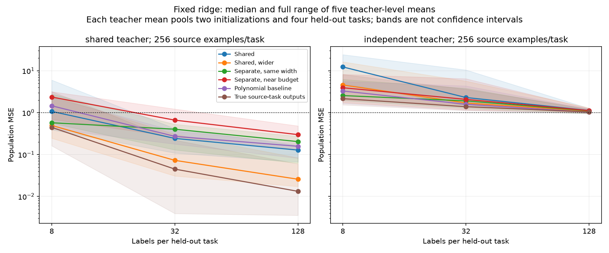

# Fresh five-teacher confirmation

This CPU confirmation supports a conditional transfer advantage for shared quadratic features, strongest when the shared student is wider. It does not establish universal sharing benefits or full circuit recovery.

## Frozen design and evidence

Five fresh teacher seeds per regime, two optimizer initializations, 12 source tasks and four whole-task holdouts. Each source task receives 256 examples; all students train for 3000 Adam steps. Adaptation receives exactly 8/32/128 labels per held-out task, with fixed minimum-norm and ridge .001 solvers. No held-out validation tuning or best-checkpoint selection. Primary comparisons were specified at 32/128 labels before training. Eighty fits and 4560 transfer records completed; no nonfinite training failure. Source/protocol hashes are saved in results/multitask_confirmation.

Shared h4 has184 parameters, shared h10 has820, separate h4 has888, and separate h1 has204. Width-matched h4 students start at identical functions. The h10 starting function differs; its exact Gaussian RMS is recorded. Near-budget comparisons still change architecture and possible function class, and Adam dynamics are not metric matched.

## Transfer results

Values below are median across five teacher-level means. Each mean averages four held-out tasks and two optimizer initializations; these are not 40 independent teacher replications. Fixed ridge .001, shared teachers, exact Gaussian population MSE (target RMS1):

| Adaptation labels | Shared h4 | Shared h10 | Separate h4 | Separate h1 | Polynomial |
|---|---:|---:|---:|---:|---:|
|8|1.071131|0.495319|0.573328|2.354351|1.457045|
|32|0.242669|0.072634|0.402491|0.662062|0.271713|
|128|0.127689|0.025747|0.203562|0.298719|0.157256|

At both primary label counts, shared h10 beats all four other methods in all five paired teacher blocks. Shared h4 beats separate h4 in4/5, separate h1 in5/5, polynomial in3/5. Thus the original h4 signal is directionally replicated, but not uniformly. Under the fixed covariance shift, h10 wins against separate h4 and polynomial in4/5 at32labels and5/5 at128labels. No broad OOD guarantee follows.

For independent teachers, median MSE at128labels is1.124(shared h4),1.086(shared h10),1.104(separate h4),1.120(separate h1),1.030(polynomial). Even true source-task outputs yield1.039 with this finite-label fixed-ridge estimator. All medians exceed the zero predictor's MSE1; this is evidence against broadly useful transfer in this condition, not a claim that the optimal projection has no predictive signal. Small-label errors can be much larger.

Source-task median population MSE: shared teachers .0533/.00548/.1509/.6499 for shared h4/shared h10/separate h4/separate h1. Independent teachers .9006/.7229/.2645/.7526. Separate features fit independent source tasks better than either shared model in this comparison.

## Components and theory

For the ten h4 shared fits on shared teachers, mean matched Gaussian quadratic-function cosine is .7845 versus .2437 at initialization;24/40 components exceed the descriptive .95 threshold. Components are correlated; recovery remains partial. This closely resembles the previous development result (.777,13/24). The exact identifiability theorem applies to independent teacher factors, complete task-product span, exact fits and h4 competitors; it does not imply recovery for overcomplete h10. Teacher factor condition numbers range17–695 (scaling dependent), so robust approximate identification requires additional analysis.

The result motivates a distinction: overcomplete sharing can improve transfer without uniquely recovering each true component. That is a testable direction, not yet a mechanism established by this experiment.

## Verification

Independent NumPy forward evaluation,512-point QR polynomial interpolation and factorial Gaussian moments verified all80 fits and4560 transfer records. Maximum relative coefficient error8.51e-15; metric errors1.34e-15; normal-equation residual2.70e-13. Independent quadratic-form geometry verified30 component comparisons, maximum cosine discrepancy8.89e-16. The generated figure was visually inspected.

Scripts: run_multitask_confirmation.py, audit_multitask_confirmation.py, summarize_multitask_confirmation.py, assess_component_confirmation.py, audit_component_confirmation.py. Evidence: results/multitask_confirmation and results/component_confirmation.

## Next bounded stage

Scale input/hidden dimensions and depth while retaining paired shared/independent teachers, matched-width and near-budget controls, whole-task holdouts, fixed adaptation rules, and failure accounting. Deeper polynomial expansions become impractical: validate a fresh Monte Carlo evaluator against these exact quartic results before using it. Use independent calibration/evaluation draws, report uncertainty and heavy-tail diagnostics, and calibrate layer scales without test leakage. Keep execution reuse separate from parameter sharing. First build and validate depth2–5 CPU smoke cases; then freeze a representative scaling grid. No GPU run has started. Overall goal remains incomplete.
