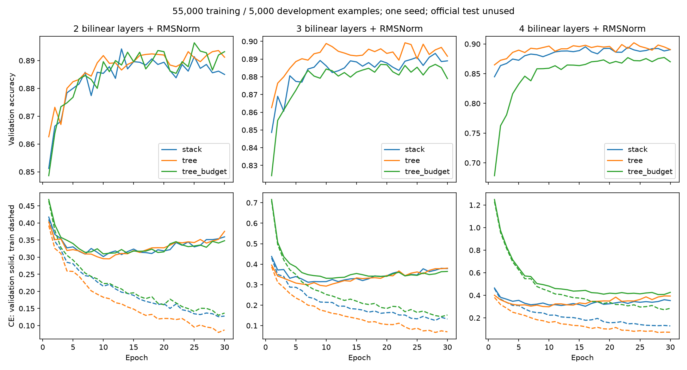

# Full-pool Fashion-MNIST development experiment

Ten classifiers trained on55,000 examples for30epochs, with5,000 validation examples and untouched official test. One seed, fixed30epoch results. RMSNorm at all bilinear nodes; no augmentation, no weight decay. Adam lr.001, batch256, clipping10. Same initial function for equal-width stack/tree at each depth. Near-budget trees change width; this comparison does not isolate parameter count from geometry. ReLU baseline has two64-wide hidden layers.

All10 final checkpoints replayed independently in NumPy, including train and validation cross-entropy/accuracy, saved validation logits, counts, split identities and source hashes. Repeated native SIGILL/SIGSEGV crashes interrupted depth4 budget-tree training. Generic CPU dispatch alone also crashed. The remaining run completed with ATEN_CPU_CAPABILITY=default and CPU affinity pinned to core0, resuming saved model/optimizer checkpoints and deterministic epoch minibatch order. Crash traces and runtime changes retained; a successful pinned run does not prove the root cause or fix. Runtime reliability remains an open issue; this is not evidence of architectural numerical failure.

| Model | Parameters | Train accuracy | Validation accuracy | Validation CE | CE change: epochs26–30 minus21–25 |
|---|---:|---:|---:|---:|---:|
| d2_stack | 52544 | 95.41% | 88.50% | 0.3594 | +0.0154 |
| d2_tree | 102720 | 97.01% | 89.12% | 0.3755 | +0.0118 |
| d2_tree_budget | 54060 | 95.18% | 89.32% | 0.3481 | +0.0033 |
| d3_stack | 54592 | 95.27% | 88.90% | 0.3786 | +0.0219 |
| d3_tree | 207168 | 97.51% | 89.16% | 0.3807 | +0.0174 |
| d3_tree_budget | 57024 | 94.72% | 87.90% | 0.3645 | +0.0075 |
| d4_stack | 56640 | 95.44% | 89.04% | 0.3532 | +0.0110 |
| d4_tree | 416064 | 97.31% | 89.06% | 0.3935 | +0.0256 |
| d4_tree_budget | 50440 | 90.76% | 87.00% | 0.4259 | -0.0001 |
| d0_mlp | 55050 | 94.88% | 88.60% | 0.3303 | +0.0109 |

These curves separate fitting from generalization. Large increases over the small pilot show that short low-data fits could not establish architecture limits. Equal-width trees generally fit training data more closely, but validation differences are small and cannot support a ranking from one seed. Late validation CE changes are descriptive, not statistical convergence tests. Do not call this a sample-complexity study: data volume, number of updates and training-fitted normalization all changed from the pilot.

Next: seed replication and nested training-size curves with both epoch- and update-budget accounting. Inspect whether longer training overfits before indiscriminately extending. Add SVHN standard versus standard-plus-extra data with separate provenance. No official-test tuning. Do not claim circuit recovery from image accuracy. Theory still concerns sharing separately from repeated inputs and physical execution reuse; normalization removes the polynomial model assumption.
