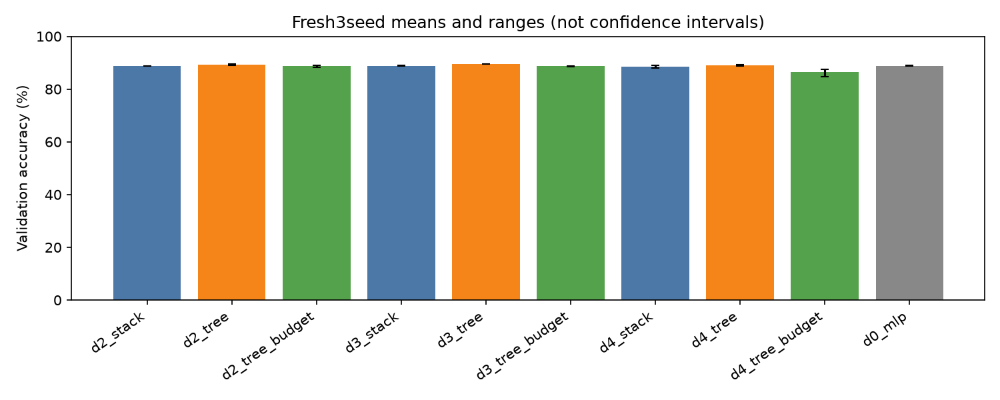

# Fresh-seed full-pool Fashion-MNIST replication

Three fresh model initialization seeds,55,000training/5,000validation,30epochs, width32, RMSNorm depths2–4, stack/equal-width tree/near-budget narrow tree andReLUbaseline. Same fixed recipe and minibatch orders as the earlier full-pool run; no early stopping or best-epoch selection. This isolates initialization variation on one fixed data split, not uncertainty across independent datasets. The original development seed is not pooled into these fresh-seed summaries. Official test remains unused.

All30models complete; independent NumPy train/validation/logit replays pass. CPUonly, genericdispatch with each producer pinned to onecore. Code, protocols, final states, optimizer states and full curves retained.

| Model | Parameters | Mean train accuracy | Mean validation accuracy | Validation range across3seeds | Mean validation CE |
|---|---:|---:|---:|---:|---:|
| d2_stack | 52544 | 95.88% | 88.76% | 88.68%–88.86% | 0.3590 |
| d2_tree | 102720 | 97.09% | 89.23% | 89.04%–89.48% | 0.3651 |
| d2_tree_budget | 54060 | 95.54% | 88.66% | 88.34%–89.10% | 0.3615 |
| d3_stack | 54592 | 95.85% | 88.83% | 88.72%–88.90% | 0.3616 |
| d3_tree | 207168 | 97.69% | 89.46% | 89.40%–89.56% | 0.3797 |
| d3_tree_budget | 57024 | 94.75% | 88.64% | 88.58%–88.72% | 0.3582 |
| d4_stack | 56640 | 95.37% | 88.45% | 88.04%–89.02% | 0.3759 |
| d4_tree | 416064 | 97.36% | 89.03% | 88.64%–89.30% | 0.4110 |
| d4_tree_budget | 50440 | 90.39% | 86.45% | 84.68%–87.44% | 0.4422 |
| d0_mlp | 55050 | 94.80% | 88.84% | 88.74%–88.92% | 0.3310 |

## Paired validation-accuracy differences

Differences below are percentage points versus the stack at the same depth and seed. Three seeds do not justify a universal architecture ranking. Equal-width trees have more parameters; budget trees change width.

- Depth2 tree: +0.74, +0.18, +0.48 points; mean +0.47.
- Depth2 tree_budget: +0.36, -0.52, -0.14 points; mean -0.10.
- Depth3 tree: +0.68, +0.52, +0.68 points; mean +0.63.
- Depth3 tree_budget: -0.30, -0.18, -0.10 points; mean -0.19.
- Depth4 tree: +1.26, -0.38, +0.86 points; mean +0.58.
- Depth4 tree_budget: -0.60, -4.34, -1.08 points; mean -2.01.

Equal-width trees gain mean accuracy by about0.47/0.63/0.58percentagepoints atdepth2/3/4, but mean validationCE is worse at everydepth. This is a small accuracy improvement with more parameters, not an across-the-board benefit. Budget trees are approximately comparable atdepth2 and weaker atdepth3/4; thedepth4budget condition is notably variable. Initializations share the same data split, and three seeds do not establish generality.

Next: broader SVHN standard/extra training comparison after checksum verification, and sample-size controls. These classification results do not establish reusable circuit recovery. Keep parameter tying, cached computation and function complexity distinct.
