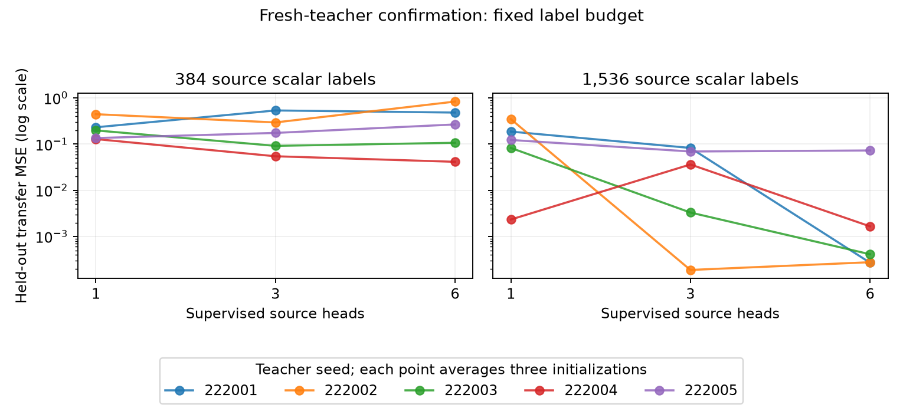

# Fresh-teacher finite-label confirmation

All120fits and independent audits complete. Five fresh teachers222001–222005, three random initializations223001–223003 per condition, and a separate teacher-start diagnostic. Prespecified recipe and endpoint are in FINITE_READOUT_CONFIRMATION_PLAN.md. Source budgets384/1536, heads1/3/6, label noise.05, fixed200evaluation cap. No restarts, best-seed selection, added teachers, or development-teacher pooling.

Primary endpoint: average Gaussian transfer MSE over four whole held-out heads after128noisy labels/head, then average all three random initializations within each teacher. Five teacher aggregates are the independent units; individual task/initialization records are not extra teacher replications. Teacher starts are privileged diagnostics, not a practical method.

| Source labels | Initialization | Heads | Median teacher transfer MSE (range) | Mean fraction with all component cosines>.99 | Budget stops |
|---|---|---:|---:|---:|---:|
| 384 | random | 1 | 0.198323 (0.128865–0.445197) | 0.000 | 12 |
| 384 | random | 3 | 0.175004 (0.0546509–0.536461) | 0.200 | 8 |
| 384 | random | 6 | 0.266925 (0.0414629–0.834869) | 0.133 | 1 |
| 384 | teacher | 1 | 0.00982376 (0.000638633–0.114419) | 0.400 | 0 |
| 384 | teacher | 3 | 0.00178933 (0.000705709–0.00347942) | 0.800 | 0 |
| 384 | teacher | 6 | 0.00283825 (0.00143152–0.00434364) | 0.800 | 0 |
| 1536 | random | 1 | 0.123145 (0.00233349–0.348219) | 0.133 | 5 |
| 1536 | random | 3 | 0.0362956 (0.000188755–0.0827385) | 0.533 | 1 |
| 1536 | random | 6 | 0.000412966 (0.000271197–0.0729641) | 0.733 | 1 |
| 1536 | teacher | 1 | 0.000599788 (0.000286885–0.00756964) | 0.600 | 0 |
| 1536 | teacher | 3 | 0.00038111 (0.000188755–0.000899862) | 1.000 | 0 |
| 1536 | teacher | 6 | 0.000412966 (0.000271197–0.000720027) | 1.000 | 0 |

## Every teacher comparison

| Source labels | Initialization | Teacher | One head | Three heads | Six heads | Oracle |
|---|---|---|---:|---:|---:|---:|
| 384 | random | 222001 | 0.231651 | 0.536461 | 0.482802 | 0.000150006 |
| 384 | random | 222002 | 0.445197 | 0.295064 | 0.834869 | 7.03006e-05 |
| 384 | random | 222003 | 0.198323 | 0.0918067 | 0.10696 | 0.000269936 |
| 384 | random | 222004 | 0.128865 | 0.0546509 | 0.0414629 | 0.000424597 |
| 384 | random | 222005 | 0.135418 | 0.175004 | 0.266925 | 0.000368427 |
| 384 | teacher | 222001 | 0.000807608 | 0.00178933 | 0.00143152 | 0.000150006 |
| 384 | teacher | 222002 | 0.00982376 | 0.00106655 | 0.00434364 | 7.03006e-05 |
| 384 | teacher | 222003 | 0.000638633 | 0.000705709 | 0.00198316 | 0.000269936 |
| 384 | teacher | 222004 | 0.010713 | 0.00347942 | 0.00347744 | 0.000424597 |
| 384 | teacher | 222005 | 0.114419 | 0.00324823 | 0.00283825 | 0.000368427 |
| 1536 | random | 222001 | 0.187085 | 0.0827385 | 0.000271197 | 0.000150006 |
| 1536 | random | 222002 | 0.348219 | 0.000188755 | 0.000277691 | 7.03006e-05 |
| 1536 | random | 222003 | 0.082825 | 0.00330736 | 0.000412966 | 0.000269936 |
| 1536 | random | 222004 | 0.00233349 | 0.0362956 | 0.0016609 | 0.000424597 |
| 1536 | random | 222005 | 0.123145 | 0.0693396 | 0.0729641 | 0.000368427 |
| 1536 | teacher | 222001 | 0.000286885 | 0.000321475 | 0.000271197 | 0.000150006 |
| 1536 | teacher | 222002 | 0.000599788 | 0.000188755 | 0.000277691 | 7.03006e-05 |
| 1536 | teacher | 222003 | 0.000364062 | 0.00038111 | 0.000412966 | 0.000269936 |
| 1536 | teacher | 222004 | 0.00180178 | 0.000899862 | 0.000720027 | 0.000424597 |
| 1536 | teacher | 222005 | 0.00756964 | 0.000670868 | 0.000641897 | 0.000368427 |

## Prespecified paired outcomes

- 384labels, random initialization: three beats one in3/5teachers; six beats one in2/5.
- 384labels, teacher initialization: three beats one in3/5teachers; six beats one in3/5.
- 1536labels, random initialization: three beats one in4/5teachers; six beats one in5/5.
- 1536labels, teacher initialization: three beats one in3/5teachers; six beats one in4/5.

At1536source labels, six heads beat one for all five fresh teacher aggregates, with median held-out MSE .000413 versus .123. Three heads win4/5. At384labels, six heads win only2/5and have worse median transfer than one. The confirmation therefore supports a budget-dependent task-diversity benefit, not the development impression that three heads should be the preferred allocation. It does not show monotonicity: six versus three is mixed, and one six-head teacher aggregate remains .073 at the larger budget.

Component recovery remains imperfect: at1536labels, all three component cosines exceed.99in11/15random six-head fits, versus8/15three-head and2/15one-head fits. The exact-teacher six-head diagnostic meets that threshold for5/5teachers. This separates practical random-initialization robustness from local statistical performance.

These are transfer outcomes at equal source scalar-label budgets, not equal input counts, parameter counts, or computational work. Four held-out128-label tasks add512labels equally to every allocation. TeacherRMSnormalization is a privileged simulation convention. Learning from three output heads need not be uniformly best, and the comparison cannot establish a universally optimal label allocation.

Independent audits replay seeded teacher/input/noise generation, nested budgets, all initializations, direct-forward Jacobians, polynomial population losses,729-node component matching, polynomial baseline and adaptation normal equations. All unsuccessful and budget-limited fits are retained;32-label adaptation and all source-fit baselines remain in JSON.

Decision: close this fixed confirmation at120fits. Interpret mixed/negative outcomes without altering the recipe. Separate transfer improvement, component recovery and random-initialization robustness before planning any larger-network extension.
