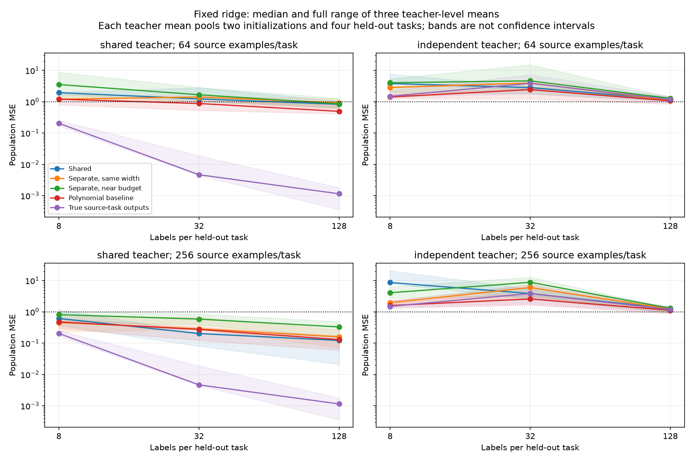

# Multi-task transfer, component identification, and instrumented graphs

This batch produces an exploratory positive transfer result for sharing, a precise cost of an incorrect sharing assumption, and an exact component-identifiability argument for a restricted but generic bilinear family. The learned models achieve partial component recovery. This is not yet a statistically confirmed scaling result or blind recovery of arbitrary neural graphs.

## Fresh multi-task experiment

Each teacher has 16 quartic task functions in eight Gaussian inputs. Twelve task heads train the representation; four entire heads are withheld. A shared teacher uses four common quadratic features and their ten unordered products for every head. An independent teacher has its own four features for each head. Targets have unit Gaussian RMS individually.

Three new teacher seeds and two independently specified optimizer seeds are used for each regime. Students train for 3,000 full-batch Adam steps on 64 or 256 common input examples per task. The readout is linear over all hidden products; it differs from the earlier factorized top-layer parameterization. This is a new controlled family, not a one-factor comparison against the earlier single-output studies.

| Student | Hidden dictionary | Parameters |
|---|---|---:|
| Shared | Four quadratic features shared by twelve heads | 184 |
| Separate, same width | Four features for each head | 888 |
| Separate, near budget | One feature for each head | 204 |

The near-budget model has 10.9% more parameters than the shared model but a different architecture and severe per-task restrictions. It is a useful control, not a complete isolation of parameter count. The same-width shared/separate pair starts with identical functions. All source datasets, optimization budgets, and evaluation conditions are matched.

Transfer features are the twelve predicted source-task outputs, normalized to unit Gaussian RMS. New task readouts get exactly 8, 32, or 128 labels and use either minimum norm or a fixed ridge penalty .001. **No held-out validation labels or test-based penalty selection are used.** The oracle comparison uses true source-task outputs, not the held-out task's hidden features. Polynomial and rank-ten polynomial baselines fit the same source labels; random-initialized networks are retained as controls.

Total: 72 network fits and 4,176 task-level transfer records, all on CPU. Entire task heads remain excluded from representation training. Exact IID and covariance-shift Gaussian errors are saved.

## A promising, conditional sharing benefit

The primary summaries below first average four held-out tasks and two optimizer initializations within each teacher, then take the median across the three teachers. The three teacher blocks, not thousands of CSV rows, are the independent units for broad generalization claims.

Shared teachers, 256 source examples/task, fixed-ridge held-out population MSE:

| Labels/new task | Shared | Separate, same width | Separate, near budget | Polynomial | True source outputs |
|---:|---:|---:|---:|---:|---:|
| 8 | 0.614 | 0.455 | 0.813 | 0.476 | 0.204 |
| 32 | 0.202 | 0.287 | 0.587 | 0.273 | 0.00465 |
| 128 | 0.122 | 0.159 | 0.329 | 0.129 | 0.00114 |

At 32 and 128 labels, shared beats both separate controls within **all three teacher blocks**. This also holds for the fixed covariance-shift OOD metric in these conditions. The OOD scores are raw MSE under the original IID target normalization, not separately normalized OOD error.

It does not consistently beat the polynomial baseline: paired wins are 2/3 teacher blocks at 32 labels and 1/3 at 128. Nor does it win every label/sample setting: at eight adaptation labels it loses to the same-width separate student by this aggregate, and at 64 source examples learning is generally poor. Fixed ridge and small sample sizes can produce unstable, nonmonotone errors. No universal advantage or tuned optimal algorithm is claimed.

The bands are full ranges across three teacher means, not confidence intervals. Both source sample sizes and both teacher regimes are retained. This is development evidence, requiring fresh teacher confirmation before a scaling claim.

## Sharing is costly when the assumption is wrong

At 256 source examples/task, median teacher-block source population MSE is 0.120 for the shared student versus 0.217 for the same-width separate student on shared teachers. On independent teachers, the order reverses: 0.948 versus 0.245.

There is a structural reason the narrow shared model cannot fit independent teachers perfectly: it confines all source outputs to a rank-at-most-ten function space, while those teacher source functions have rank twelve. A Gaussian-metric singular-value tail gives irreducible average source-MSE lower bounds of 0.0828, 0.0750, and 0.0904. Observed errors exceed these bounds substantially; not all failure is explained by capacity.

Unrelated held-out tasks also fall outside the independent teacher's true source-output span. Even an oracle of those source functions has nonzero projection floors of 0.647–0.957. Transfer errors are often around or above the zero-predictor MSE of one. This is not a failure to recover shared features that actually exist; these new heads were generated with new dictionaries.

## From a function span to identifiable computations

The [task-span note](TASK_SPANS_AND_GRAPH_IDENTIFICATION.md) establishes that diverse known task functions identify their common feature-function span when their readouts have full rank. With finite observed input samples, that does not by itself recover the entire polynomial span.

The stronger [component-identifiability theorem](GENERIC_BILINEAR_COMPONENT_IDENTIFIABILITY.md) adds bilinear structure: if the teacher's 2h linear factors are independent and tasks span all h(h+1)/2 hidden products, any exact fit with h bilinear hidden features must recover the teacher's quadratic feature functions up to scaling and permutation. The proof uses a square-root subspace lemma and the rank-two constraint on individual bilinear forms. Fewer features cannot span the tasks; overcomplete competitors and incomplete task coverage are excluded.

The three shared teachers satisfy the assumptions. The learned models do not fit exactly, so the theorem does not certify their recovery. Direct gauge-aware assessment finds:

- At 64 source examples/task, mean matched quadratic-function cosine improves from 0.238 initially to 0.430; none of 24 correlated component instances exceeds .95.
- At 256 examples/task, it reaches 0.777, with 13/24 above .95.

This is partial recovery, not full circuit recovery. Exact counterexamples show why incomplete task spans and dependent input factors invalidate uniqueness. No literature-novelty claim is made, and no robust approximate-identifiability bound is yet proved.

## Generic fiber dimension and a local learning coefficient

The [fiber/RLCT note](GENERIC_FIBERS_AND_LOCAL_RLCT.md) connects this identifiable family to the proposal’s geometry questions. An exact integer Jacobian certificate establishes generic rank176 among184 parameters; eight independent factor-rescaling directions account for the generic fiber. Under an explicitly realizable Gaussian regression likelihood and a smooth positive prior in a compact local chart, this yields local RLCT88 with multiplicity1. This is a regular quotient calculation, not an empirical RLCT estimate or a result for degenerate, misspecified, or overcomplete states.

## Physical reuse needs stronger observations

A separate eight-template graph study independently toggles parameter-storage tying, selected input-leaf tying, and intermediate-state reuse. It does not claim to recover the unknown graph of the trained multi-task networks.

All eight templates fit the ordinary diagonal-input observations exactly. A compression tie-break chooses the fully shared graph and identifies only 20/160 actual teachers. Addressed parameter, leaf, and intermediate-state interventions each reveal one sharing bit; all three identify 160/160, with exact prediction of fresh compound interventions. Each missing probe leaves a twofold ambiguity. Off-diagonal passive inputs could reveal the input-leaf bit, but not identical recomputation versus physical state reuse in this family.

This is recovery within a known, noiseless template family with given intervention targets. It demonstrates the distinction between observational equivalence and execution identity; it is not blind graph discovery from output labels.

## Verification and next decision

- All 72 fits and 4,176 transfer rows pass independent NumPy-forward and 512-point QR polynomial interpolation checks. Largest coefficient discrepancy is 8.57e-15; metric discrepancies are below 1.22e-15 scaled; transfer normal-equation residuals below 8.86e-13.
- Teacher task ranks and exact oracle-transfer cases are checked. Shared oracle minimum-norm transfer at 32/128 labels reaches maximum population MSE 2.06e-29.
- DAG/formula gradients and parameter-tie pullback agree. An independent literal graph interpreter validates 1,280 intervention cases and all resource counts; all 1,280 compatible-graph sets are checked.
- Component recovery is audited through an independent Gaussian quadratic-form metric, maximum cosine discrepancy 8.89e-16; exact coefficient counterexamples pass.

Next: confirm the task-transfer signal on at least five fresh teachers with separately varied optimizer seeds and stronger budget controls, including a wider shared trunk near the separate model's total parameter count. Preserve the fixed-penalty comparison as primary; any new meta-validation scheme must use additional source-side tasks rather than labels from the held-out test heads. Then proceed to controlled depth/width scaling if the evidence supports it. The full research goal remains active.
