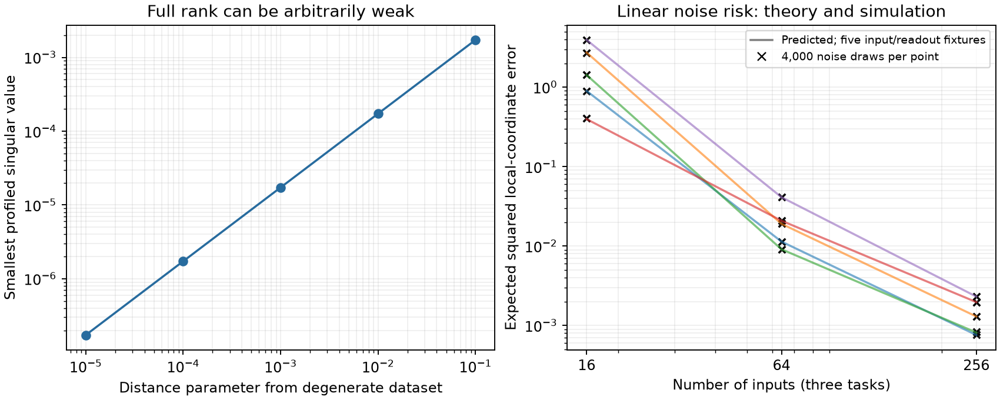

# Hidden information, noise sensitivity and local learning rates

This extends the sampled-rank result into local statistical and optimization geometry. It concerns a fixed shared bilinear representation, squared loss, freely fitted linear readouts, and a specified local chart after factor scaling is removed. It does not rank optimizers globally or establish nonlinear recovery from random initialization. The arguments are elementary; novelty has not been assessed.

## Profiled information

Let predictions be Phi(theta)W and let Y=Phi(theta0)W0 at the reference state. Use the unaveraged loss L=1/2 ||Phi(theta)W-Y||_F². Write B for the prediction derivative in hidden coordinates and R for the derivative in readout coordinates. If Phi has full column rank, projecting onto col(R) eliminates the best linearized readout change. Define

    A = (I - P_R) B,     I_hidden = A^T A.

For a hidden direction v,

    v^T I_hidden v = min_deltaW ||D Phi[v] W0 + Phi deltaW||_F².

At a noiseless exact-fit point this is also the Hessian of the profiled loss ell(theta)=min_W L(theta,W). Residual-dependent Hessian terms vanish there. For independent Gaussian observation noise of variance sigma², I_hidden/sigma² is the efficient local Fisher information after treating readouts as nuisance parameters. Factors are expressed in a fixed unit-row tangent chart: eigenvalues depend on that metric, although rank does not. None of these assertions silently adds ridge regularization.

## Two monotonicity results, with budget caveats

**Adding inputs:** keep the same reference parameters and tasks, and append input rows while retaining every old observation with the same weight. For any v, write the old and new squared residual contributions as f(deltaW) and g(deltaW)>=0. Then

    min_deltaW [f(deltaW)+g(deltaW)] >= min_deltaW f(deltaW).

Therefore I_hidden,new - I_hidden,old is positive semidefinite. Readout refitting does not invalidate this statement; the same readout perturbation must explain both sets of inputs.

**Adding task heads:** each task has its own readout perturbation and its own squared residual. Minimization separates across tasks, so the new information is the old information plus the nonnegative information of the added heads. A head can add magnitude even after rank has saturated. Repeated measurements also add precision without adding rank when their noise is independent.

These statements do not compare allocations at fixed total labels, guarantee better optimizer endpoints, or say that eigenvalues of average-loss Hessians must increase. Dividing by N or by the number of tasks changes the scale; deleting observations to maintain a fixed budget changes the problem. Correlated noise requires the corresponding covariance-weighted information, rather than simply counting repeated labels.

## Exact local noise calculation

In the linearized observation model, projection leaves A v plus projected isotropic noise. If A has full column rank, unregularized least squares gives

    Cov(v_hat) = sigma² (A^T A)^(-1),
    E ||v_hat-v||² = sigma² trace((A^T A)^(-1)).

Although projected observation noise is correlated, A lies in the projector range, which yields the displayed covariance. This is exact for the linearized model. It is not a finite-noise guarantee for a nonlinear estimator, nor a claim that a training algorithm will find the local solution. At rank deficiency, these formulas apply only to an identified subspace with the appropriate restriction; unobservable components cannot be estimated without further assumptions.

## A local gradient-flow consequence

In a smooth local hidden chart, suppose A has full column rank at the exact fit and let mu=lambda_min(A^T A)>0. Full-rank Phi persists in a sufficiently small neighborhood, so the profiled loss is smooth. Hessian continuity supplies a sufficiently small convex chart ball on which Hess ell >= (mu/2) I. Starting inside this ball, Euclidean reduced gradient flow stays inside: the squared distance to the center has derivative at most -mu times that distance squared. Consequently the parameter distance is at most exp(-mu*t/2) times its initial value. The usual strong-convexity loss bound is ell(theta(t)) <= exp(-mu*t) ell(theta(0)).

This is a local basin statement with an unspecified radius; no global initialization guarantee follows. The flow uses Euclidean coordinates in that chart. Unit-row manifold flow has a variable metric and requires corresponding local metric bounds; arbitrary Adam updates are not covered. For mean squared loss the information and time scale must be divided by its normalization. Away from an exact fit, residual curvature terms can invalidate the Hessian identification.

## Full rank does not provide a uniform robustness bound

The exact certificate supplies two eight-input datasets for the same d4/h2 model with W=I: X0 has profiled rank11 and X1 has rank12. Rescale their input coordinates by 1/3 and 1/30 respectively; nonzero uniform input rescaling preserves these ranks. Consider the rational path X(delta)=(1-delta)X0+delta X1.

A full-rank Jacobian minor is nonzero at delta=1, hence is a nonzero polynomial along the path and can vanish at only finitely many delta. Phi retains full column rank near delta=0. Thus arbitrarily close to zero there are full-rank profiled problems. Their smallest singular value tends to zero by continuity, because the endpoint has rank11. Inputs remain bounded and the factor rows and readout remain fixed. Therefore generic full rank, bounded inputs and normalized factors alone imply no positive uniform information lower bound and no uniform local noise-risk or convergence-rate guarantee. This argument uses exact endpoint certificates; it does not rely on numerical detection of extremely small singular values.

## Checks and observations

`check_profiled_information.py` checks 60 Gaussian-input configurations (five seeds, N=8/16/64/256, one/three/six task heads). The hidden chart has12 coordinates. An explicit nuisance-readout Jacobian and least-squares elimination independently reproduce the profiled derivative. All85 nested-input/task information differences pass positive-semidefinite checks with scale-aware floating-point tolerance.

Fifteen full-rank linearized-noise experiments use4000 independent Gaussian draws each. Predicted mean squared hidden-coordinate error is sigma² trace(I_hidden^-1); the largest relative Monte Carlo discrepancy is1.997%. These are linear-model checks, not15 nonlinear training experiments. The unit noise scale is permissible for the exact linear model and must not be interpreted as a small-noise nonlinear approximation test.

Along the rational path above, delta=.1,.01,.001,.0001,.00001 all have numerical rank12, while their smallest singular values are approximately .001724,.0001727,.00001727,.000001727,.0000001727. Thus reducing the perturbation by10,000 makes the weakest local noise variance roughly100 million times larger, despite unchanged numerical rank. The delta0 rank11 endpoint is independently certified exactly. This observed scaling is illustrative, not a proved asymptotic power law.

## Consequence for the research plan

The larger task/input grid should be interpreted using both information and optimization diagnostics. Simple dimension counts cannot explain every failure. A next bounded mechanism experiment can measure profiled information spectra at teacher and trained states, first at tractable width; compare predicted local sensitivity with actual small-noise local fits before using it to explain random-start training. Do not reopen closed readout-speed sweeps merely to seek a favorable optimizer ranking. The current h64 scientific training/evaluation remains a separate ongoing requirement.
