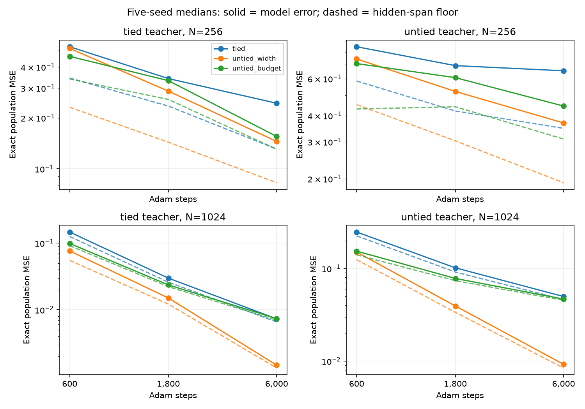
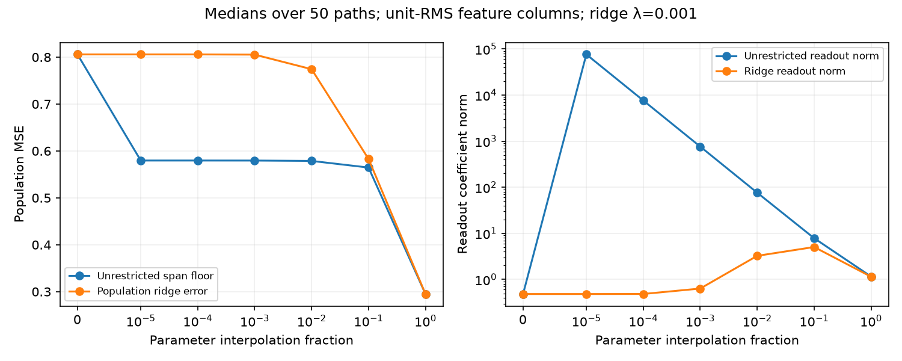

# Learning features, fitting readouts, and singular capacity

This batch distinguishes three issues: how good the fixed learned features are, how much their readouts leave unused, and whether more training improves the features. It also exposes a conditioning caveat in using linear-span rank as a recovery metric.

## Completed experiments

- Refit all 150 frozen d=8 trained states, their exact initializations, and oracle teacher features. Two readout classes (top product units, or all hidden products), minimum-norm and validation-selected ridge: **1,400 readouts**, plus 700 population projection diagnostics.
- Extend 60 predeclared optimization trajectories at N=256 and 1024, both teacher types, all three student types and five seeds, from 600 through 1,800 to 6,000 Adam steps. All **60 original 600-step states replay exactly**. No optimizer reset, learning-rate change, early stopping, or test-based checkpoint selection. Save and audit 180 snapshots.
- Evaluate seven points on all 50 initial-to-600-step hidden-parameter paths of width-matched untied students: **350 geometry records**, plus analytic Hessian/noise checks.

All work ran on CPU. No numerical training failure occurred. All producers and auditors are terminal. No GPU work or native-MLP research was resumed.

## The features are learned, but the final scalar readout is not the main remaining problem at larger N

Using exact Gaussian L² projection, compute the lowest possible error of any linear readout from a fixed representation. This truth-aware population calculation is a diagnostic lower bound, not an available trained predictor.

Training lowers the hidden-span floor relative to its initialization in 147/150 cases. For example, at N=1024 with tied teachers:

| Student | Original model MSE | Refit top weights, validation ridge | Refit all hidden products, validation ridge | Best possible hidden readout |
|---|---:|---:|---:|---:|
| Tied | 0.1469 | 0.1459 | 0.1413 | 0.1257 |
| Untied, same width | 0.07635 | 0.07633 | 0.07058 | 0.05512 |
| Untied, near budget | 0.09906 | 0.09910 | 0.09920 | 0.09176 |

Entries are five-seed medians, not ratios or decompositions of the medians. The exact decomposition is verified per example. At the same setting, the initial tied/width-matched hidden-span floor is about 0.8045. Thus substantial useful representation learning occurred, but merely refitting the scalar output weights cannot remove most remaining error.

The all-hidden-product readout enlarges the top class beyond its original factored parameterization. At small N its larger dimension can worsen finite-data generalization even when its population floor is lower. Validation ridge can also yield slightly worse test/population error than an existing model; only its validation selection criterion is guaranteed. No claim of a universally beneficial post-hoc repair is made.

## More optimization substantially improves the features

Median exact population MSE after 600 → 6,000 steps:

| Teacher | N | Tied | Untied, same width | Untied, near budget |
|---|---:|---:|---:|---:|
| Tied | 256 | 0.527 → 0.244 | 0.515 → 0.145 | 0.463 → 0.155 |
| Tied | 1024 | 0.147 → 0.00731 | 0.0764 → 0.00148 | 0.0991 → 0.00737 |
| Untied | 256 | 0.852 → 0.655 | 0.745 → 0.369 | 0.708 → 0.445 |
| Untied | 1024 | 0.248 → 0.0499 | 0.151 → 0.00923 | 0.154 → 0.0468 |

Population MSE improves in 58/60 trajectories. Hidden-span floors improve substantially too: on tied teachers at N=1024, median floor goes from 0.1257 to 0.00658 for tied students and from 0.0551 to 0.00134 for width-matched untied students. The 600-step results are therefore not evidence of immutable architecture limits or a failure to learn any useful representation.

The wider untied student still beats the tied student in all five paired seeds for both N settings on tied teachers at 6,000 steps. It wins 9/10 on untied teachers. Equal-budget comparisons remain architecture-confounded; no universal advantage, convergence theorem, or optimized-compute comparison follows. At N=256, data underdetermine the full 330-coefficient quartic function, so extra optimization need not solve the generalization problem. Larger-N quartic least squares still recovers the exact target much more directly.

## Formal capacity can appear before usable capacity

The [singular readout note](SINGULAR_READOUT_GEOMETRY.md) derives an exact example: features `(u,u+εv)` can recover v at every nonzero ε, but need coefficient norm √2/|ε|. Readout conditioning worsens like ε⁻², and independent feature noise is amplified by 2σ²/ε². Perfectly correlated common-mode noise cancels instead. These statements specify the noise model; they are not generic claims that cancellation is fragile.

In all 50 bilinear-model interpolation paths, hidden-product rank rises from 36 at equal branches to 64 at ε=10⁻⁵. The median ideal population floor immediately drops from 0.806 to 0.580, but requires readout norm about 76,379 even after unit-RMS normalization of the feature columns. Fixed ridge λ=.001 keeps median error essentially 0.806. At ε=1 the unrestricted readout norm is only about 1.16 and ridge and unrestricted errors nearly agree.

This does not prove the mechanism explains every neural training result. The paths are interpolations, not optimizer trajectories, and the population projections use privileged target knowledge. It does prove why unregularized span improvement alone is insufficient to claim stable, learnable structure. Required readout norm and conditioning are necessary companion measurements.

## Verification

- All 1,400 refits audited against direct feature evaluations. Maximum relative prediction discrepancy 2.57e-14; normal-equation residual 2.02e-13; population projection discrepancy 5.56e-16; Pythagorean identity discrepancy 3.56e-15. Original trained population errors replay within 3.93e-16 scaled error.
- Ridge selections checked against saved complete validation grids; unselected candidate fits were not independently rerun.
- All 180 optimization snapshots checked with independent NumPy-forward/Gauss-Hermite integration: maximum relative population-MSE discrepancy 4.61e-15. All 60 initial checkpoints replay bit-for-bit, and population floors agree with an independent least-squares calculation within 2.23e-16.
- All 350 singular paths checked using pivoted-QR least squares instead of the producer's SVD filter, and a direct linear solve for ridge. Maximum scaled discrepancies: floor 5.45e-12, coefficient norm 1.47e-10, ridge error 1.36e-14.
- Seven analytic Hessian cases pass; independent-feature noise Monte Carlo matches the predicted amplification within 0.4%; common-mode cancellation is verified.

## Next research decision

Stop extending this single-output optimization sweep. It has served its purpose: features do improve with optimization, readout-only fixes have limited effect at larger N, and rank gains can be poorly conditioned. Another larger step budget would not by itself establish reusable computation.

The next stage should test reuse across multiple tasks and explicit observation regimes. A shared hidden dictionary used by several independent output heads can be evaluated on new held-out heads with few labels. This supplies an operational transfer test that the current single-output comparisons lack. For graph recovery, distinguish output-only equivalence from access to interventions on internal computation nodes; label-only observations cannot distinguish a reused state from identical recomputation with tied parameters.

Keep whole tasks held out, account separately for parameter count and execution cost, and measure feature-span fidelity with conditioning-aware diagnostics. E3 recovery and E4 depth/width scaling remain required and unfinished. No fresh confirmation panel has yet been run.
