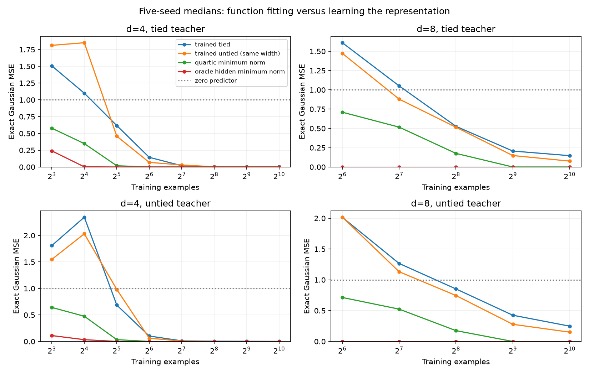

# Regression controls and d=8 scale-up — 2026-10-29

The strongest result of this batch is a large gap between fitting the target polynomial and learning its hidden representation through the bilinear network. There is still no established general tying advantage. This remains CPU-scale development evidence, not a scalable circuit-recovery result.

## What changed

Added 640 fixed-feature regressions on the exact original d=4 datasets, a 150-fit d=8 neural comparison, 400 fixed-feature regressions on those d=8 datasets, and algebraic tests of multiplication kernels and output width. All processes completed successfully on CPU; no GPU job was started or interrupted.

The d=8 run uses h=8, top width=8, Adam learning rate 0.003, 600 steps, N=64,128,256,512,1024, both teacher types, and five paired seeds. The tied and width-matched untied students start with the same function. Parameter counts are 264 (tied), 392 (width-matched untied), and 248 (nearest-budget untied, h=5). The budget match is approximate, 6.1% below the tied count, and changes the architecture.

This uses the pasted script's dimensions, learning rate, and step count, but is **not an exact replication**: it retains the audited harness's float64, independently generated shared datasets, nested sample sizes, teacher-only exact-population-RMS normalization, function-matched initialization, budget control, and final-checkpoint evaluation. It does not select the best test checkpoint. Changing from d=4 to d=8 also changes width and learning rate; this is a larger problem test, not a clean one-factor dimension-scaling law.

## Linear controls

For each teacher and sample size, compare four fixed feature maps:

1. All homogeneous quartic monomials, minimum Euclidean coefficient norm.
2. The same function space, whitened using the known standard-Gaussian population moment matrix, minimum norm in that basis.
3. Products of the teacher's hidden features: unordered pairs for tied teachers, left-right pairs for untied teachers.
4. The teacher's final product-unit outputs, learning only their scalar weights.

For each map, retain both unregularized minimum-norm least squares and ridge selected by validation over a fixed ten-value grid (including zero). No test or exact population error selects a penalty. Different feature bases impose different penalties, so ridge and minimum norm are not parameterization invariant. Oracle features are privileged teacher information, not learned representations or equal-information competitors.

## d=4: previous neural errors were not forced by missing data

At N≥64, raw quartic least squares recovers every target to population MSE below 1e-16 across all 50 teacher/sample-size cases. There are 35 coefficients. The trained networks' nonzero errors therefore cannot be attributed to insufficient information to identify the polynomial on these datasets. For realizable students, optimization and its implicit biases are sufficient candidate explanations; for mismatched or narrower students, function-class restrictions may additionally matter.

At N=16 on tied teachers, median population MSE is 0.349 for raw quartic minimum norm and 0.00238 with oracle hidden features. The earlier trained tied student had median 1.099. Thus its small advantage over the matched untied student did not establish a useful advantage over simple polynomial regression.

## d=8: the gap survives the larger problem

The full quartic space now has 330 coefficients. Median exact Gaussian population MSE:

| Teacher | N | Trained tied | Trained untied, same width | Trained untied, near budget | Quartic minimum norm |
|---|---:|---:|---:|---:|---:|
| Tied | 64 | 1.611 | 1.473 | 1.793 | 0.710 |
| Tied | 256 | 0.527 | 0.515 | 0.463 | 0.176 |
| Tied | 1024 | 0.147 | 0.0764 | 0.0991 | numerical zero |
| Untied | 64 | 2.015 | 2.017 | 1.472 | 0.714 |
| Untied | 256 | 0.852 | 0.745 | 0.708 | 0.175 |
| Untied | 1024 | 0.248 | 0.151 | 0.154 | numerical zero |

At N=512 and 1024, quartic minimum norm recovers every target below 1e-16 (20 cases). Oracle hidden products recover all d=8 targets below 1e-16 already at N=64. Their coefficient-map dimensions are 36 for tied teachers and 64 for untied teachers; all sampled maps have full column rank. This is strong evidence of an available low-dimensional representation, but **not** evidence the neural optimization learns it.

The original teacher type does not guarantee misspecification of the tied student; teacher construction alone is not a proof that a function lies outside another architecture. Five paired seeds mix teacher and initialization variation. No statistical confirmation or convergence claim is made.

## Theory that helps interpret the controls

The [polynomial quotient geometry note](POLYNOMIAL_QUOTIENT_GEOMETRY.md) derives the minimum number of bilinear top units for a fixed symmetric form Q: max(number of positive eigenvalues, number of negative eigenvalues). For actual hidden features, optimize this quantity over all Q that produce the same polynomial, because input reuse can introduce a kernel in the multiplication map.

Example: with h=(x²,xy,y²), the function x⁴+y⁴ has a two-positive-square lift, but also equals `(x²+√2xy+y²)(x²−√2xy+y²)`, a single product. Both lifts have rank two. We verify the identity and 80 symmetric factorizations numerically. This clarifies why a chosen lift's rank, signs, or cancellation are not automatically intrinsic measures of the function's computational cost. No novelty claim is made.

For d=4,h=6, the untied oracle hidden products span all 35 quartic coefficients despite having 36 nominal coordinates. Successful hidden-feature readout fitting there cannot establish special feature recovery. At d=8,h=8, the smaller oracle spaces (36 or 64 out of 330 dimensions) provide a more discriminating recovery target.

## Validation and limitations

- All 150 d=8 neural fits passed independent NumPy-forward/Gauss-Hermite integration, maximum relative population-MSE discrepancy 4.61e-15.
- All 1,040 regression records passed an independent audit of direct oracle feature values, saved-coefficient predictions on regenerated train/validation/test inputs, factorial-expression Gaussian moments, selected-solution normal equations, and coverage. Maximum scaled normal-equation residual is below 4.01e-14.
- The regression audit verifies the selected ridge solution and that it is no worse than lambda=0 on validation; it does not independently rerun every candidate in the selection grid. The producer retains the fixed selection code and protocol.
- Full-rank raw quartic solutions are verified to recover the actual target coefficients/function, not merely the finite training labels.
- Models have not been trained to proven convergence, optimizer hyperparameters were not tuned, and gradient clipping remains active. These results concern the specified training procedure and budget.

## Next experiment

Freeze each learned d=8 representation and refit (a) only its top output weights and (b) a complete linear readout over its hidden products. Compare the same refits for random initialized and oracle representations, with identical data and validation-selected regularization. This distinguishes a deficient final readout from failure to learn the useful hidden subspace. The unrestricted hidden-product readout enlarges the top function class; record that explicitly rather than calling it a harmless optimizer repair.

Do this before increasing training budgets, moving to deeper networks, or claiming graph recovery. Afterwards, independent teacher panels and controlled depth scaling remain part of the active goal.
