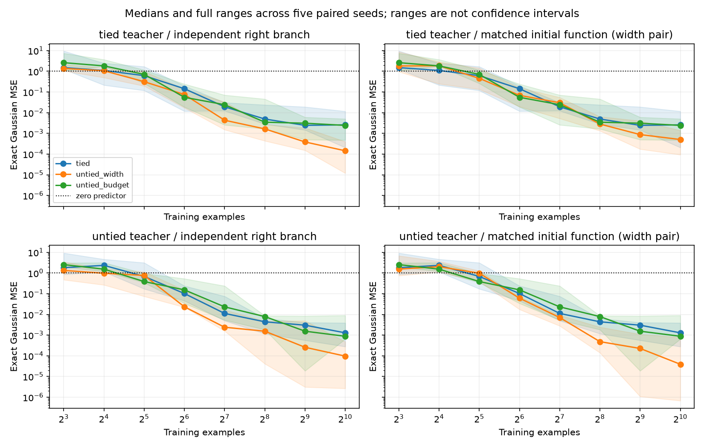

# Initial CPU results — 2026-10-29

The implementation and geometry controls pass. These experiments do **not** establish a general sample-efficiency advantage from tying. There is one small-N advantage under matched initialization, but the overall result depends on initialization, width, sample count, and optimization budget. No GPU scaling or circuit-recovery claim is justified yet.

## Completed work

- E0: 24 float64 checks. Nonzero-reference relative errors in the revised checks are below 3e-16. The original `results/e0` used mixed absolute/relative scaling; all training runs repeat the revised stricter checks. Exact historical source snapshots match each frozen protocol hash.
- E1 pilot: both teacher types, three students, three seeds, N=256, 600 full-batch Adam steps: 18 fits.
- E1 sweep: both teachers, three students, five seeds, N=8,16,32,64,128,256,512,1024: 240 fits. Repeated with function-matched initialization for the width-matched pair: another 240 fits. The other two arms intentionally replay exactly (160 checks), so these are not 480 statistically independent fits.
- E2 metric control: one fixed tied teacher, five initializations, four update rules, 300 SGD steps on the same 4,096 inputs: 20 trajectories. Initial functions match exactly. This is a dynamics control, not a converged optimizer tournament or the complete E2 program.

Everything ran on CPU, float64, one thread per process. E1 records contain no nonfinite-loss/gradient failures. The maximum number of clipped steps in the initial sweep was 81/600; clipping and fixed optimization duration remain interpretation limits.

## E1: what happened

Exact Gaussian population MSE, median across five paired seeds, at N=256:

| Teacher | Initialization of width pair | Tied, 100 params | Untied, 148 params | Untied budget, 100 params |
|---|---|---:|---:|---:|
| Tied | Independent right branch | 0.004932 | 0.001645 | 0.003471 |
| Tied | Same initial function | 0.004932 | 0.002821 | 0.003471 |
| Untied | Independent right branch | 0.004396 | 0.001543 | 0.007872 |
| Untied | Same initial function | 0.004396 | 0.000483 | 0.007872 |

At N=256,512,1024, the wider untied student beats the tied student for every paired seed on the tied teacher, in both initialization settings. This is not evidence that additional parameters alone explain the result: the different function class, metric, optimization speed, and implicit regularization remain entangled. It does rule out assuming tying helps just because the teacher uses tied features.

At N=16 on the tied teacher with matched initial functions, tied beats the wider untied student in all five paired seeds (median MSE 1.099 versus 1.851). It beats the budget-matched student in four of five (median 1.825). On the untied teacher the tied student wins only two of five against the matched wider untied student. This is a candidate interaction, not confirmation: the N=16 condition was examined alongside many others, the independent-initialization advantage is weaker (three of five), and all these medians exceed the zero-predictor MSE of 1. There is no strong useful-generalization result at this setting yet.

Equal-budget comparisons across the whole grid are mixed. No uniformly preferred architecture emerges. Individual seed results, paired differences, learning curves, sparse-input/covariance-shift errors, and initialization diagnostics are preserved; do not replace these with a single winning mean.

Shading is the full five-seed range, not a confidence interval. “Same initial function” applies only to the tied versus width-matched untied pair, not to the narrower budget control. Seeds vary both teacher and initialization. This is development evidence; no independent confirmation cohort has been run.

## E2: the metric matters, and the control is exact

Multiplicity-corrected tied SGD and orthogonally projected occurrence SGD agree throughout all five trajectories. Maximum absolute parameter discrepancy is 4.663e-15. Ordinary tied SGD differs, as predicted by the induced metric. Free untied SGD can leave the tied subspace even when initialized within it.

Median exact Gaussian MSE after the deliberately short 300-step run:

| Update rule | MSE |
|---|---:|
| Ordinary tied SGD | 0.78536 |
| Multiplicity-corrected tied SGD | 0.88333 |
| Projected occurrence SGD | 0.88333 |
| Free untied SGD | 0.84492 |

These are not tuned or converged solutions. Their purpose is to verify that the metric correction isolates the mathematical equivalence. Initial/final probe Jacobian singular values and empirical NTK eigenvalues are saved in `results/e2_metric/results.json`. The probe is small and the fixed training set is reused; no spectrum-to-generalization causal claim follows.

## Independent validation

For both full E1 sweeps, `audit_results.py` evaluates saved student and teacher weights through an independent NumPy forward path, then integrates squared error using a tensor-product five-node Gauss-Hermite rule. This integrates squared quartic polynomials exactly in exact arithmetic and does not use the producer's monomial-expansion routine. Maximum relative discrepancy with the reported population MSE is 8.281e-14 for the initial sweep and 1.879e-13 for matched initialization. Teacher second moments equal 1 within 1.555e-15. Parameter counts, run coverage, completion, and evidence hashes also pass. All 480 saved fit records are audited; the earlier 18-fit pilot did not save final weights and is not included in this independent audit.

## Consequences for the proposal

1. Parameter tying is a concrete restriction and a change of metric; it is not automatically a statistical advantage, even for a tied teacher under a fixed training budget.
2. Pure deterministic intermediate reuse versus duplicated tied computation is observationally equivalent. E0 verifies equal outputs and gradients. Execution cost is a distinct resource, but cannot by itself induce different gradient learning dynamics in this setup.
3. Recovering coefficients or predicting OOD inputs does not identify the actual teacher DAG. E3 needs a declared equivalence class or hidden-state intervention access before “graph recovery” is a measurable claim.
4. At d=4 there are only 35 homogeneous quartic coefficients. Large-N differences here are mainly about fitting/conditioning/optimization, not proof of scalable sample efficiency.

## Next discriminating work

Before another parameter sweep, add an unstructured quartic regression baseline with the same sample sets (minimum-norm solution and a validation-selected regularized version), and an oracle teacher-feature regression baseline. This separates difficulty learning features from fitting coefficients and tests whether the small-N advantage amounts to a useful prior. Preserve the current runs as development, not confirmation.

Then, if justified, use a fresh fixed teacher panel and separately vary initialization seeds; compare matched initial functions under explicit metric controls and predeclared step/time budgets. Do not keep expanding budgets or selecting learning rates on the test results until a desired winner emerges.

For E3, first specify a small identifiable graph family and the observations that disambiguate it. Parameter count, arithmetic DAG size, and operation count should remain separate reported resources. GPU work and broader SLT claims remain deferred.
