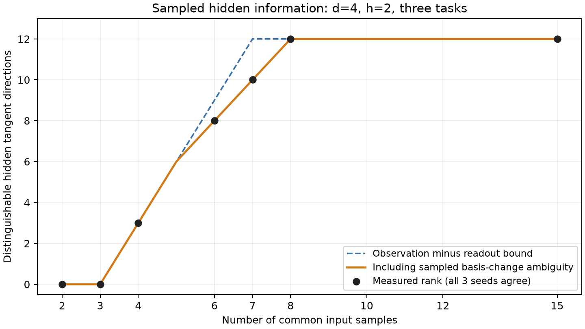

# Sampled constraints after refitting readouts

Consider noiseless observations Y=Phi(theta)W, with N common input samples, P hidden-product features and T task outputs. Readouts W are freely refitted. This note concerns unregularized least squares at an exact-fit point; positive ridge introduces a preference for readout norm and is a different objective. These are elementary projection/rank arguments, not a novelty claim.

Let r=rank(Phi), Pi project onto its column space and s=rank(W). For a hidden perturbation v, eliminate the best linearized readout change. Its remaining observable prediction change is

    A[v]=(I-Pi) D Phi[v] W.

Proof: the full change is D Phi[v]W+Phi deltaW; minimizing over each readout column removes precisely its component in col(Phi). The output range of A lies in matrices with columns in col(Phi)^perp and rows in row(W). That space has dimension (N-r)s, hence

    rank(A) <= min(q, (N-r)s),

where q is the hidden tangent dimension after removing known continuous parameter symmetries. With full column rank Phi, r=P and s<=min(P,T). A necessary condition for nonsingular first-order identification of all q hidden directions is therefore

    (N-P) min(P,T) >= q.

This is NOT a sufficient condition, a general sample-complexity theorem, or a necessary condition for every possible higher-order/singular notion of identification. It says nothing about the magnitude of the nonzero singular values or whether an optimizer finds the teacher.

When N<=P and Phi has full ROW rank, the stronger conclusion holds: for every nearby theta that retains full row rank, every Y can be interpolated by some W. The unregularized profiled training loss is identically zero in that neighborhood. Adding tasks on exactly those same inputs does not identify the hidden representation from interpolation loss alone. Regularization or other priors can select a representation but introduce information beyond that criterion.

For h distinct generic quadratic factors (a_i dot x)(b_i dot x), using unit a_i and b_i removes both row scale freedoms. There are q=2h(d-1) hidden orientation parameters. Under the independent-factor/full-product-task assumptions used in the earlier identification theorem, no further continuous hidden ambiguity is expected generically; the rank inequality itself remains valid as an upper bound even if additional ambiguities exist. Factor swaps and permutations are discrete.

For the current d64/h32 experiment, P=528 and q=4032. The necessary dimension-count thresholds are N>=559 for132heads and N>=536 for528heads, conditional on the stated regular/full-rank setting. Both actual N=2048 and8192 lie far above them. Consequently, this elementary count cannot explain any remaining learning failure in that grid. Conditioning, finite-sample geometry and optimization must still be measured.

Once W already has row rank P, adding noiseless heads at the same inputs cannot enlarge the possible row space in this bound. Additional independent noisy tasks may still improve statistical precision and conditioning; saturation of a rank bound is not saturation of useful information.

## A second bound from sampled hidden values

For the full unordered-product readout, write Z in R^(N×h) for the sampled hidden quadratic values and Phi(Z) for their degree-two monomials. Assume N>=h and Z has full column rank. Replacing Z by ZR for any invertible h×h matrix R changes Phi by an invertible linear change of feature basis, which freely refitted readouts absorb. The GL(h) orbit has dimension h²: the map K -> ZK is injective. Consequently the ambient sampled-hidden-value derivative, after readout profiling, has rank at most Nh-h². Restricting this derivative to actual parameter perturbations cannot increase its rank. Combining bounds yields

    rank(A) <= min(q, (N-r)s, h(N-h)).

The sampled GL(h) ambiguity need not extend to a global symmetry of the bilinear factors: generic linear mixtures of factorable quadratics are not factorable. This is a bound on the information in finite evaluations through this readout architecture, not a claim of h² additional global parameter gauges.

For d4/h2, q=12 and P=3. At N=7 with three independent tasks, the first bound permits rank12 but the second limits it to10. At N=6, the bounds are9 and8. This explains why an observed derivative can fail to saturate the naive observation-minus-readout count even at generic points. First-order full recovery additionally requires N>=h+ceil(q/h); this is still only necessary.

check_sampled_hidden_information.py evaluates the actual normalized bilinear feature Jacobian for d4/h2, three seeds, seven input counts and three task counts. It checks the projection identity against finite differences of the exactly refitted residual and audits numerical ranks at two thresholds. Numerical rank measurements are illustrative, not exact algebraic certificates.

## Numerical findings

All63fixtures pass; ranks agree at both relative thresholds. With three or six tasks, observed ranks at N=2,3,4,6,7,8,15 are0,0,3,8,10,12,12 for every seed. With one task they are0,0,1,3,4,5,12. Thus N=7 does not reach the naive count12, while N=8 reaches12 in these fixtures, consistent with the second bound. The largest finite-difference derivative discrepancy is1.49e-8. Three independent direct product/readout refits also verify finite GL(2) basis-change invariance. Those numerical fixtures alone provide no exact-rank certificate or conditioning lower bound; the separate exact extension below establishes generic ranks for the three-task case.

## Exact finite-sample certificate: seven versus eight inputs

The separate script `certify_sampled_information.py` now certifies the three-task d4/h2 case with integer arithmetic, finite-field minors and independent SymPy rational ranks. Write the two hidden features as z1=x1*x2 and z2=x3*x4, and take the three readouts to be z1², z1*z2, z2². There are 25 raw parameters: 16 factor entries and nine readout entries. At full-column-rank Phi the readout derivative has rank nine. Profiling it out gives rank(A)=rank(J_full)-9, by the dimension formula for the sum of the hidden and readout derivative ranges.

Four independent continuous scaling directions preserve outputs: reciprocal scaling within each quadratic and scaling each quadratic while compensating its readout columns. The stored Jacobians annihilate all four explicit directions. Together with the previous sampled-value and observation bounds,

    rank(J_full) <= 9 + min(12, 3(N-3), 2(N-2)).

For each N in {4,6,7,8,15}, three input fixtures drawn from integers -30 through 30 attain this upper bound. Selected minors have nonzero determinants modulo the prime 2147483647, proving nonzero determinants over the rationals. Their profiled ranks are respectively 3,8,10,12,12. The script independently checks every Jacobian column by exact central differences at steps one and two: each output has degree at most two in any individual parameter, so these differences are exact derivatives here. SymPy rational elimination agrees with every modular rank.

A nonzero minor is a polynomial witness. Therefore, outside a proper algebraic subset of joint inputs and parameters, these ranks are attained in the full-rank regime. For these dimensions and three independent product tasks, eight generic inputs suffice for full first-order hidden identification modulo the four scaling freedoms; seven cannot. At N=8 the generic local fixed-output fiber has dimension 25-21=4, exactly the scaling-orbit dimension. At N=7 it has dimension 25-19=6, leaving two further local degrees of ambiguity beyond scaling. This is local identification, not global uniqueness, an optimization theorem, a noise tolerance or a useful conditioning bound.

### Retained degeneracies and protocol amendment

The first attempt used inputs from -3 through 3 and incorrectly asserted that every fixture must attain the generic bound. It stopped at seed260101,N6 with full rank16 rather than17. We removed that unjustified assertion, retained all 15 original fixtures, and added a separately identified broader-range suite using the same three seeds. Exact rational ranks certify the original deficits; they are not floating-point threshold artifacts or modular-prime rank losses.

| Integer input range | Seed | Profiled ranks at N=4,6,7,8,15 |
|---|---:|---|
| -3…3 | 260101 | 3,7,9,11,12 |
| -3…3 | 260102 | 0,3,5,7,12 |
| -3…3 | 260103 | 0,6,8,10,12 |
| -30…30 | all three seeds | 3,8,10,12,12 |

Both suites keep full sampled Z rank two and Phi rank three. Thus those two rank checks alone do not ensure generic hidden information. These examples support the distinction between nominal sample count and informative input coverage. They do not estimate how often such degeneracies occur under Gaussian sampling. The broad-range suite supplies algebraic witnesses, not an unbiased empirical success-rate estimate. All 30 input sets, Jacobians, selected minors and ranks are saved in `results/sampled_information_certificate/certificate.json`. No literature novelty claim is made.
