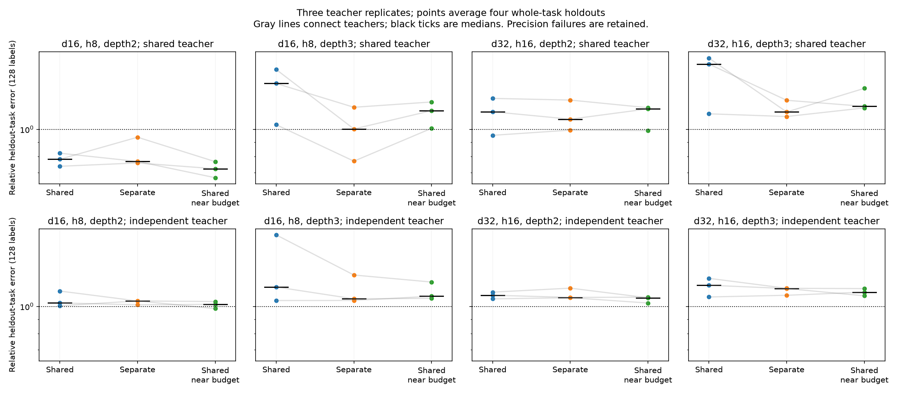

# Representative scaling: limited sharing advantage and a task-output bottleneck

All72CPU fits and independent replays completed. The strong small-model sharing advantage did not generalize uniformly under this larger, fixed600-step training recipe. An exact calculation exposes a separate bottleneck: twelve source-task predictions discard much of the larger teachers' hidden feature space.

## Frozen sweep

Configurations d16/h8 and d32/h16 at depths2/3 (input degrees4/8), two teacher regimes, three teacher replicates, three student architectures. Each teacher has12source tasks and4whole-task holdouts. Training uses1024importance-weighted sphere examples, Adam lr.001 for600steps, clip10. Source-only teacher gradients guide training proposals; calibration has additional privileged labels. This is not an equal-total-supervision sample-efficiency claim. Width-matched students begin at identical functions; wider students have separately normalized initial outputs. All models use fixed independent output calibration.

|d,h,depth|Shared params|Separate params|Near-budget shared width/params|
|---|---:|---:|---:|
|16,8,2|688|3504|21 /3444|
|16,8,3|816|5040|23 /5106|
|32,16,2|2656|13920|43 /14104|
|32,16,3|3168|20064|46 /20148|

Budget ratios differ by less than2%; function classes and optimizer metrics still differ. Teacher initialization seeds are disjoint. Held-out outputs never guide source proposals, student initialization, source loss or checkpoint selection. Adaptation uses32/128labels and fixed ridge.001 over12predicted source outputs, normalized on independent source-only calibration. The true-source-output baseline gets the same adaptation labels/solver. Final evaluation may access held-out functions solely to sample and measure errors; it never changes training or adaptation fits.

## Transfer results

Median across three teacher-level means, each averaging4held-out task relative errors, at128adaptation labels. Relative error1 is zero prediction. Shared teachers:

|Configuration|Shared|Separate|Near-budget shared|True source outputs (approx)|
|---|---:|---:|---:|---:|
|d16,h8,depth2|.782|.768|.723|.56|
|d16,h8,depth3|1.459|1.003|1.167|.62|
|d32,h16,depth2|1.156|1.088|1.184|.96|
|d32,h16,depth3|1.712|1.154|1.209|1.33–1.38|

The near-budget shared student beats separate in3/3paired teachers for d16depth2 at128labels. The corresponding counts for the other three configurations are0/3,2/3,1/3. At32labels the pattern is also mixed. Independent-teacher median128-label transfer errors exceed1 for all configurations/models. Full records retain every replicate and negative result.

Seventy of72source metrics and470of576learned-transfer task/label metrics pass the descriptive batchCV<10% gate. Failures are retained, not filtered. These small teacher samples and precision failures do not support fine rankings or universal claims. Models often have poor population source fit too: larger dimensions and fixed1024examples/600steps change optimization and generalization demands. This does not establish that sharing intrinsically worsens learning.

## Exact depth2 diagnosis: the measured representation is too narrow

The earlier h4teacher has10quadratic-product features. Twelve diverse source tasks can span all10, so unseen task heads lie in the source-output span. At h8 and h16, there are36and136such features, while we still transfer through only12source predictions.

For the six shared depth2teachers, compute the exact Gaussian task Gram K using Wick pairings. Each feature is a product of4linear forms; its inner product with another feature involves8Gaussian factors and105pairings. This integrates the hidden-feature Gram without expanding all input monomials. Task Gram is W G W^T. An independent5-node tensor Gauss-Hermite fixture validates the pairing implementation to6.11e-16relative discrepancy.

The optimal population linear prediction of heldout tasks from exact source outputs has residual Gram

K_HH - K_HS K_SS^(-1) K_SH.

Normalize its diagonal by heldout target energies. Mean floors over4heldouts are:

- d16,h8: .3910, .4131, .4424 across the three teachers.
- d32,h16: .7390, .8060, .7790.

Source head rank12 and all-task head rank16 in every case. This is a numerical evaluation of exact Gaussian moment identities in float64; source Gram conditions4.67–42.36are reported. Homogeneity makes the same relative floors apply on the sphere.

These are bounds for the **exact source-output span**, not for all learned hidden representations. Approximate source predictions can even contain extra directions, so do not apply this as a universal lower bound on every learned student. The result establishes that source-output transfer alone cannot diagnose whether a larger hidden dictionary was learned. Finite adaptation and ridge add further error beyond the exact projection floor.

## Verification and resources

All72fits complete600steps with no nonfinite training failure. Independent NumPy replay verifies source targets/objectives, both learned and oracle ridge normal equations, and all saved evaluation outputs/aggregates; maximum relative forward discrepancy3.16e-15. Design audit verifies actual parameter counts,204distinct teacher initialization seeds, frozen source/dependency hashes, and source output/input-gradient invariance under heldout-parameter mutations. Figure visually inspected.

Producer ran roughly8minutes on CPU; its last observed elapsed time before completion was489.6seconds. Observed process memory high-water was1,379,160kB (~1.32GiB). Per-fit timing covers training plus final analysis/evaluation after initialization and is not total end-to-end cost. No GPU work was needed. Full states, proposals, seeds and per-example weighted evaluation arrays are saved in results/scaling_grid.

## Next experiment and scope

First compare source-output transfer against direct hidden-feature transfer using these same frozen models and adaptation inputs, with fixed penalties and independent feature normalization. Include the teacher's true hidden-feature dictionary as a privileged oracle. This needs no retraining and directly tests whether the measurement compressed away reusable information. Preserve whole-task holdouts; avoid selecting penalties on their errors. Only afterward consider increasing source-task diversity or optimizer budget.

This representative scaling sweep is complete; the overall research goal is not. Broad benefits, robust unprivileged deep learning and general circuit recovery remain unproven. Depth4/5limitations are documented in the earlier bounded experiments, not silently omitted.

Scripts: run_scaling_grid.py, check_scaling_design.py, audit_scaling_grid.py, summarize_scaling_grid.py, exact_scaling_task_span.py. Frozen protocol and all audits are in results/scaling_grid.
