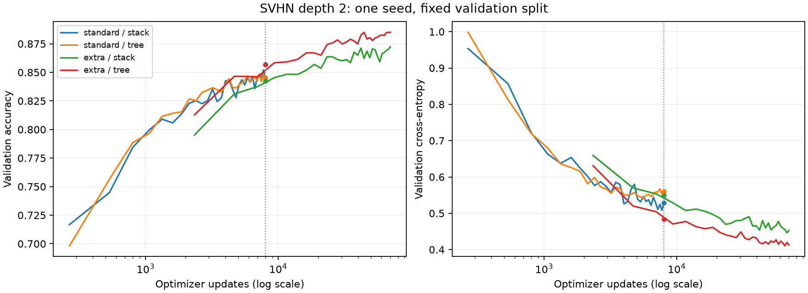

# SVHN extra-data GPU comparison

Four depth-2 fits completed on RTX 5080 in float32 with TF32 disabled. All final training/validation metrics and both final and 8,010-update validation predictions replay independently in NumPy. All models use width 32, per-node RMSNorm, Adam .001, batch 256, gradient clipping at 10, and the same model seed. Equal-width stack/tree functions agree at initialization; tree occurrences have independent parameters.

Standard training uses 68,257 examples; added-data training uses 599,388 (including all 531,131 extra examples). Both use the identical 5,000-example validation split and normalization fitted only on standard training. Official test remains unused. No augmentation or convolution.

| Data | Architecture | Parameters | Validation at 8,010 updates | Validation at 30 epochs | Final CE | Final train accuracy |
|---|---|---:|---:|---:|---:|---:|
| standard | stack | 198976 | 84.54% | 84.54% | 0.5287 | 88.53% |
| standard | tree | 395584 | 84.54% | 84.54% | 0.5598 | 90.62% |
| extra | stack | 198976 | 84.24% | 87.24% | 0.4528 | 94.06% |
| extra | tree | 395584 | 85.70% | 88.50% | 0.4130 | 95.50% |

Standard 30 epochs equal 8,010 optimizer updates and 2,047,710 examples seen. Extra-data 30 epochs equal 70,260 updates and 17,981,640 examples seen. Its 8,010-update snapshot sees 2,050,068 examples (slightly more because incomplete epoch-end batches differ). This controls optimizer-update count, not exactly compute, distinct examples, or data distribution.

Interpretation: the equal-epoch comparison combines more distinct data with more training. The matched-update comparison constrains that confound but extra images also have a different distribution. This is one initialization on a fixed development split, not a seed-robust advantage or a pure sample-size causal estimate. Training accuracy is measured on different data pools and should not be directly compared as if tasks were identical. Accuracy does not establish circuit recovery.

Next: extend paired GPU controls to depths 3 and 4, then replicate seeds where differences persist. Retain parameter-budget and width-allocation caveats from the previous standard-data studies. Do not infer convergence solely from completing 30 epochs.
