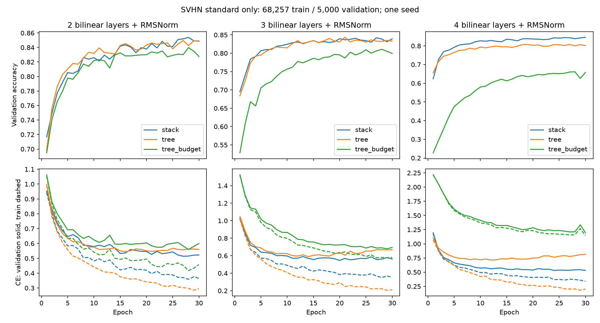

# Standard-only SVHN: full-pool development comparison

All10classifiers trained for30epochs on68,257standard-training images;5,000validation images from the same official training split. Official test untouched. One initialization seed, shared data/minibatch order, Adam.001,batch256,clip10. RGB channel statistics fit on training only, flatten NCHW, no augmentation. RMSNorm at every bilinear node. Finalepoch results, no best-epoch selection or early stopping. This is a new dataset development experiment, not a multi-seed benchmark claim.

Raw data from UCSDmirror matched the reference archive checksum; cachedarray SHA256 and splits verified. Independent integer-channel-histogram moments verify normalization. NumPy forwards independently replay train/validation metrics and saved logits; matched initial stack/tree functions checked. All training isCPU. A separate brief RTX5080agreement test passed: maximum relative float32gradient difference~2.92e-6 andfloat64~4e-15, withTF32disabled. NoGPUtraining sweep has run.

| Model | Parameters | Dense MAC/example | Train accuracy | Validation accuracy | Validation CE |
|---|---:|---:|---:|---:|---:|
| d2_stack | 198976 | 198976 | 88.92% | 84.86% | 0.5225 |
| d2_tree | 395584 | 395584 | 90.88% | 84.92% | 0.5599 |
| d2_tree_budget | 197280 | 197280 | 86.17% | 82.76% | 0.5997 |
| d0_mlp | 201482 | 201344 | 88.13% | 82.84% | 0.6349 |
| d3_stack | 201024 | 201024 | 89.11% | 83.94% | 0.5626 |
| d3_tree | 792896 | 792896 | 93.66% | 83.30% | 0.6699 |
| d3_tree_budget | 197072 | 197072 | 82.76% | 79.96% | 0.6948 |
| d4_stack | 203072 | 203072 | 89.58% | 84.58% | 0.5305 |
| d4_tree | 1587520 | 1587520 | 93.74% | 80.16% | 0.8152 |
| d4_tree_budget | 196872 | 196872 | 66.68% | 65.78% | 1.1942 |

The depth2tree is essentially tied with the stack (84.92% versus84.86%). Atdepth3/4the equalwidthtree fits training better but validates worse, especiallydepth4(80.16% versus84.58%). The depth4uniformbudgettree reaches only65.78% validation and66.68% training, consistent with a fitting bottleneck under this recipe. One seed doesnotestablish an architecture law. A proposed budget-allocation control keeps upperlayerswidth32 while reducing leafwidth, to separate totalparameterbudget from a narrowed outputrepresentation.

Dense MAC counts include matrix products only, excluding pointwise products, normalization, activations and memory costs. They are not measured FLOPs or wall-time guarantees. Near-budget trees change width; equal-width trees change parameter counts and execution cost. Hold those distinctions when interpreting accuracy.

Next: standard-plus-extra data with the same standard validation split and normalization, and a matched-update checkpoint/control as well as equal-epoch results. Do not equate extra-data gains with a causal sample-size effect without accounting for optimizerupdates and theextra split's distribution. Replicate seeds before general architecture claims. Classification accuracy does not identify reusable circuits.
